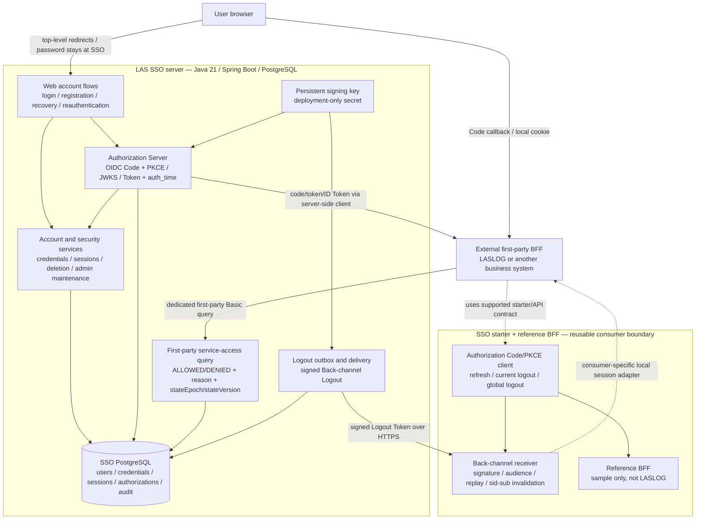

# LAS SSO Architecture and SSO-Only Delivery Roadmap

- Date: 2026-10-02
- Last verified scope update: 2026-10-07 — .20261006.7 V15 HMAC IDToken-hint continuity after refresh, actual Grafana desktop/mobile Viewer verification and two five-minute TLS mixed workloads; full505server/193starter/37reference735 zero skips. Production monitoring transport/on-call/remaining probes, hours-scale ramp/soak/history sizing/scans/DAST and broaderB1 remain separate.
- Status: SSO-only architecture and delivery overview; implementation and production acceptance remain separate
- Chinese counterpart: [SSO 架构与 SSO 专属交付计划](../zh-CN/architecture/sso-architecture-and-roadmap.md)
- Detailed status: [implementation status/issues/plan](../implementation/status-issues-and-plan-2026-10-02.md)

## 1. Scope and ownership

Current [delivery .7](../integration/development-delivery-2026-10-06-7.md) repairs refresh→globalLogout hint continuity under [ADR-0011](../adr/0011-preserve-id-token-logout-hint-association.md) and verifies [real Grafana/mixed TLS load](../operations/grafana-mixed-load-2026-10-07.md). HMAC-only association does not broaden AT/RT lookup or change credentials/permissions/auth_time. Per mode five subjects/nine sessions,45sfixtureAT, five-minute closed-loop results are not production sizing/soak. Earlier scope remains historical.

Current [delivery .20261006.6](../integration/development-delivery-2026-10-06-6.md) implements the [SSO monitoring subset](../operations/monitoring-and-alerting.md): independent stateless collector credentials/separate management port, fixed-category counters/timers and cached DB gauges; three real alert/recovery notifications and dashboard expressions verified. It does not add a consumer credential/port/table or business permission, deploy production monitoring, or repeat earlier administrator/restore drills on .6.

Current [delivery .20261006.5](../integration/development-delivery-2026-10-06-5.md) repairs database readiness after a real outage and repeats [TLS/admin/restore on final JARs](../operations/final-artifact-acceptance-2026-10-06.md). [Bounded capacity](../operations/capacity-readiness-2026-10-06.md) records query/login/hash/JVM/pool and database fail/recover; domain metrics/private export/alerts and production sizing remain pending. The .4 dependency baseline is preserved and scans repeated; older paragraphs retain historical scope.

Latest [delivery .20261006.3](../integration/development-delivery-2026-10-06-3.md) verifies [TLS/proxy/Cookie boundaries](../operations/tls-proxy-acceptance.md) with a private network and the actual forwarding include/reference https profile. This is isolated transport acceptance, not official certificate provisioning or production trust-chain deployment. Earlier paragraphs retain their recorded historical scope.

Current [delivery .20261006.2](../integration/development-delivery-2026-10-06-2.md) repairs authorization continuation after old SSO credentials/session revocation and verifies real administrator maintenance at the [recorded layer](../operations/administrator-maintenance-acceptance.md). Earlier restore/queue/browser paragraphs retain historical evidence; production/promoted-user/admin expiry/operator custody/complete UI acceptance remains separate.

Latest [delivery .20261006.1](../integration/development-delivery-2026-10-06-1.md) and [ADR-0010](../adr/0010-executable-restore-epoch-barrier.md) implement SSO-side expected-epoch/interactive recovery, with real old-snapshot restore/new persistent key/old Token rejection. A consumer generation barrier in that exercise is fixture-only; actual relying-party implementation remains external. Prior delivery paragraphs below describe their historical snapshots.

Current [delivery .4](../integration/development-delivery-2026-10-05-4.md) and [ADR-0009](../adr/0009-reference-bff-durable-token-revocation.md) provide reference-only durable encrypted work via existing sink. Default starter keeps its public API/memory behavior; this sample proves committed queue restart recovery, not durable business Sessions or atomic local logout/outbox.

Current [delivery .3](../integration/development-delivery-2026-10-05-3.md) adds default before/during-registration Logout protection under [ADR-0008](../adr/0008-retain-sid-revocations-before-local-registration.md), preserves SPI signatures and records maintenance-script exact artifact/hash checks. Historical .2 scope below remains evidence for that earlier snapshot, not the current fingerprint.

Latest acceptance record: [delivery .2](../integration/development-delivery-2026-10-05-2.md) documents the real UserInfo302 diagnosis/explicit Bearer-converter repair, 15 focused cases,639 full cases and actual default/application-owned BFF Edge sessions/reauthentication/current/global logout/Back-channel. Prior phase paragraphs retain their historical boundaries; this local HTTP flow does not close production TLS/proxy, consumer high-risk gates or durable ordering.

This document manages only LAS SSO, `las-sso-spring-boot-starter` and the reference BFF. Other business systems are external relying parties. They are shown as consumers and acceptance inputs, not as work owned by this SSO plan.

SSO owns:

- stable identity subject, credentials, password authentication and recovery;
- SSO browser sessions, OIDC authorizations/tokens and account lifecycle;
- first-party service-access eligibility;
- SSO-side logout signaling, audit/security events and recovery/maintenance controls;
- the reusable starter contract and reference-BFF behavior.

SSO does not own business roles, invitations, projects, Minecraft identities, whitelist entitlements, server bans or a consumer's local authorization database.

## 2. SSO architecture diagram

### Trust boundaries

| Boundary | SSO rule |
| --- | --- |
| Browser to SSO | Password is entered only at SSO; CSRF, same-origin and risk limits remain on password operations |
| SSO to OIDC client | Confidential client exchanges Code server-side; client verifies issuer, audience, signature, state/nonce/PKCE and time |
| SSO to first-party query consumer | Dedicated first-party client credentials; human OIDC tokens are not service-access query credentials |
| SSO to BFF logout receiver | Signed, short-lived, typed Logout Token; receiver must not treat it as a grant or account-state event |
| SSO database to consumers | No consumer reads the SSO database; consumers receive supported OIDC/query contracts only |
| Signing key | SSO-only secret; never exposed through claims, BFF APIs or admin UI |

## 3. Current SSO status

| Capability | Current status | Expected status |
| --- | --- | --- |
| Identity/account/password | Implemented foundation; production/browser acceptance pending | Stable UUID subject, password/recovery lifecycle, no business permission claims |
| JDBC SSO sessions | Implemented and PostgreSQL-tested | Session expiry/revocation/security-version behavior verified in supported deployment |
| OIDC Code + PKCE/Token | UserInfo repair and real Edge Code/JWKS/Token/UserInfo over controlled HTTPS proxy verified | Official domains/certificates/proxy trust topology and external consumer acceptance |
| Password reauthentication |18 focused OIDC cases including revoked-cookie restart; real browser challenge/password/auth_time and administrator reset/new-login verified | Preserve password/browser/request evidence; consumer pending-operation/fifteen-minute gate remains external |
| Service-access query | Epoch/wire17/smallTCPload retained; .20261006.1 real restored lower counter/new epoch verified | Production restore/actual consumer generation barrier/in-flight refusal, proxyTLS/sustained capacity/observation SLA |
| Login risk | Prior root/context HTTP matrix plus .20261006.3 actual HTTPS browser/proxy IP-budget/CAPTCHA and spoof-resistant plain/encoded login gates | Production20/50 window rollover, CDN/multihop IP normalization, concurrency/capacity/full UI |
| Logout | B3/B4 receipts plus real default/application-owned HTTPS current/global/logout and CA-validating Back-channel verified | Custom/durable adapters/crash/restart/order, official production transport/external consumers |
| Starter security chain | Public composition/lifecycle/B5 plus trusted authorization-builder overload, PKCE/target/signed auth_time consumer access2 new callbacks; identified dev artifact compile | Real consumer pending local operation/15m/revocation/browser/shared-store, preserve application checks/authority |
| Starter session/Token ownership |193 cases/.3 default sid ordering plus real default/application-owned BFF dual-login/current/global/logout acceptance; process-local/HttpSession | Durable adapters/restart/custom notification ordering/committed release/shared Session remain separate |
| Admin/client/lifecycle | S2 concurrency evidence retained; actual empty-DB hidden bootstrap/first-change/offline reset/recovery download and old state refusal verified in .20261006.2 | Populated promotion/deletion cancellation, live expiry/production terminal/custody, client rollout/grant races/capacity/crash |
| Development delivery | Current.20261006.7/source303/18artifactscriptconfig/3unchangedlocks/735tests; V1–V15/nativePOM/scans/final mixedTLS/Grafana | Committed source/signature/hosted immutable/external production acceptance |
| Health/capacity/monitoring | DBreadiness/.6metricsalert paths; .7 actual Grafana1440/390 Viewer import/render and two five-minute mixedTLS modes/12,598operations/120refresh0reuse | Production privateTLS/credential rotation/on-call/Grafanaauthretention; remaining probes/hours-scale ramp-soak/largeDB/history sizing |
| Dependency baseline | Boot4.1.1/Framework7.0.9/Tomcat11.0.26/Jackson3.1.7/BC1.86/pgJDBC42.7.13/Log4j2.25.5, Security/AS7.1.1; 17 baseline CVEs no longer reported, source warning disposition retained | Release-time advisory refresh, final consumer graph, production image/OS/JDK/proxy/log/DAST and continuous scanning |
| Production readiness | Not ready | Full scanning, browser/HTTP/deployment/backup/version-delivery evidence |

Original issue IDs remain authoritative: A1–A3, S1–S6, B1–B5 and dependency advisory D1. The reauthentication delivery does not close them.

2026-10-03 B1 evidence correction: the previous logout test proved calls occurred, not their order; the strengthened test exposed submission before removal, now fixed. The dual-Session timeout was a missing latch countDown, not proven ID collision. New 10 runtime cases use real Spring filters/manager/provider/repository and loopback HTTP, but fixture authentication/Mock Servlet requests: no signed callback, live SSO/browser/Tomcat, durable adapter, restart or production evidence. The B1 task did not rerun server DB tests and retained a 130-test report; the subsequent S1 task did rerun them, as follows.

### S1 atomic recovery invalidation — verified scope

The original three-case PostgreSQL regression ran before the repair: ordinary/required password change both allowed stale recovery completion (two failures, zero skips); the failed-change control passed. A later controlled race exposed promotion allowing an unused administrator-issued credential to create a new recovery session after promotion committed. Both defects now have passing regressions under the original S1 issue ID.

Implementation uses existing tables and a common `users` row lock, with no migration or new version-binding field. Ordinary/required change and recovery creation/completion lock the target user before associated credential/session state. Candidate UUID reads are not authorization evidence: after acquiring the lock, recovery rechecks the same subject, exact current username/credential or unconsumed, unexpired recovery session and reads the current time. Maintenance retains its advisory lock, then locks the user before associated state. Promotion revokes ordinary recovery codes, administrator-issued credentials and pending sessions; ordinary/required change consumes pending sessions in its existing credential transaction. Public convenience overloads are also transactional when invoked through Spring. Existing independent rate-limit/rejection-audit transactions remain and are tested.

The 28-case `PasswordRecoveryInvalidationIntegrationTest` uses actual PostgreSQL 18.4, Spring-proxied services and `pg_blocking_pids` to observe controlled lock waits. It covers both commit orders for creation/completion versus ordinary/required change, promotion and maintenance reset, administrator-issued creation races, two-session completion, rollback, expiry after waiting and independent failure evidence. Self-service recovery still preserves unused codes from the existing batch; change/promotion/reset revoke old credentials. No authentication factor, recovery entitlement or lifetime was changed. S3 lifecycle lock ordering and S4 promotion/deletion policy were open at this S1 stage; their subsequent evidence is recorded below.

Related focused suites: 87 passing cases (28 + 6 + 53), zero failures/errors/skips. Full execution: `.\gradlew.bat test :las-sso-reference-bff:compileJava --rerun-tasks --no-daemon --console=plain`, **158 server + 37 starter tests**, zero failures/errors/skips; reference BFF was recompiled and has `test NO-SOURCE`. These are service/database and existing MockMvc checks, not browser/proxy, interactive maintenance drills, production capacity, multi-instance deployment or final logout delivery acceptance. See the status map §3.3 for red/green commands and timestamps; changes remain uncommitted/unpublished/undeployed.

### SSO-01/B2 public composition and callback registration

The original B2 signed-flow regression failed after successful Code/PKCE exchange, RSA/JWKS verification, Token save and Session ID change: a valid immediate Logout Token returned 204 but did not invalidate the just-created local session. Callback success now registers verified sid/sub under the final local Session before delegating the application redirect. Failed registration removes local authorization/authentication/session and emits `SESSION_REGISTRATION_FAILED`. Re-login replaces the old identity index; public destruction/ID-change hooks and a custom response-only error writer are available.

`LasSsoSecurityConfigurer` is shared by the default chain and application-owned chains; it wires PKCE, the LAS repository, one refresh/index filter, success registration, current logout and the POST-only receiver CSRF exception. Applications keep their route authorization and success delegate. Duplicate installation fails. Four storage/work SPIs and existing public refresh constructors remain compatible. The reference BFF has a compiled optional `application-security` profile. Full supported API/examples/limits: [English](../integration/starter-security-composition.md) / [Chinese](../zh-CN/integration/starter-security-composition.md).

`LasSsoOidcCallbackIntegrationTest` has 14 passing cases, plus two new refresh-error-hook cases. It exercises actual Spring filters/providers/repositories/managers and loopback HTTP Code/PKCE/JWKS with signed ID/Logout Tokens; inbound Servlet, ID event dispatch and receiver terminal routing remain fixtures. No MVC binding, live SSO/browser/container, persistence/restart/multi-instance or deployment evidence is claimed. That step's full forced rerun at 22:04–22:05 Asia/Shanghai: **158 server + 53 starter**, zero failures/errors/skips; reference BFF recompiled, `test NO-SOURCE`. This step changed no dependencies/locks or schema.

B2's callback-return→next-request window is repaired/verified at that layer. Token/index persistence is not a distributed transaction, and logout arriving before/during registration or concurrent in-flight requests still needs coordination/acceptance. No tombstone/cache strategy was silently added. B3–B5 were subsequently repaired as recorded below; durable acceptance, client password-reauthentication hooks and version delivery remain open. SSO-01 public hooks are source-delivered, not production acceptance.

### B3 sender acknowledgement and bounded retries — 2026-10-04

Both sender regressions failed before the repair: real HTTP 302 marked server outbox processed, and the default revocation queue never retried its original endpoint. They now inspect status directly through `RestClient.exchange` and explicitly disable redirect following using the existing factory. Back-channel accepts exactly 200/204 per the existing LAS contract; revocation accepts exactly 200 per RFC 7009 §2.2 and ignores response content. Other 2xx (including 202), redirects and errors remain failures under the unchanged eight-attempt/random-exponential retry policy. No schema/transaction boundary, HTTP dependency, circuit breaker or status-specific retry policy was added.

Server rejected responses retain unprocessed state, increment attempts, clear claim fields, and ultimately persist `dead_lettered_at`; a later acknowledgement clears the error and completes. The starter stops/logs after eight attempts without a durable dead-letter record. Status errors use `HTTP_<status>` and transport errors a non-secret class; worker/exhaustion logs omit response body, URI/exception detail, Token and secret. Local logout and sink acceptance remain distinct from remote acknowledgement and arbitrary receiver database effects.

`BackChannelLogoutDeliveryIntegrationTest` 20 cases use actual PostgreSQL 18.4, signed sender and HTTP; retries are made due by fixture updates. `LasSsoTokenRevocationQueueTest` 18 cases use real HTTP; one uses production scheduling, the matrix records delays with an injected package-private scheduler to avoid long waits. Tests cover exact success, rejected statuses, no redirect forwarding, transport failure, recovery, eight-attempt exhaustion, receiver independence and targeted secret-log checks. Related focused tests: 73 server/20 starter. Full forced rerun at 00:10–00:12 Asia/Shanghai: **178 server + 71 starter**, zero failures/errors/skips, reference BFF recompiled and `test NO-SOURCE`.

No live TLS/proxy/BFF/OP, slow-body/timeout capacity, stale-claim races, full-duration retry scheduling, crash/restart or multi-instance deployment was tested. B4 receiver/replay semantics, B2 broader ordering and durable consumer work remain open. Sources/commands and limits: [English receipt contract](../integration/logout-delivery-acknowledgements.md), [Chinese](../zh-CN/integration/logout-delivery-acknowledgements.md), status map §3.5. Work remains uncommitted/unpublished/undeployed.

### B4 strict validation and execution receipts — 2026-10-04

Original 18 focused cases ran before repair, with 13 failures: signed invalid claims accepted, array events throwing, repeat execution, execution faults misclassified as 400 and failed registry invalidation yielding 204. User explicitly selected additive Replay SPI `process` while retaining `accept`: old accept-only adapters compile but reception fails closed 503 until upgraded. This intentional runtime change is recorded in [ADR-0003](../adr/0003-logout-replay-execution-receipts.md) and its [Chinese counterpart](../zh-CN/adr/0003-logout-replay-execution-receipts.md).

Strict default RS256/JWKS/type/fixed issuer decoding is followed by mature Nimbus verified payload type checks, covering numeric sub coercion that occurred before Spring conversion. Receiver requires first-party sid, jti, empty logout event, iat/exp (120s maximum, 60s skew), no nonce, correct issuer/audience. The process API reserves issuer/jti/digest, records success only after invalidation, caches identical success without another action, returns conflict 400/in-progress 503, and releases failed execution while retaining digest through exp+60s. Default registry removes successful indexes and retains still-live failures/partial retries. Logs contain categories only.

Final suites: 33 actual RSA/HTTP JWKS/controller cases, 15 receiver-execution cases and five replay cases, plus 14 callback/one Bean test; a 68-case related subset in the full run. Last focused stage ran 67 zero-failure cases before the final fixed-issuer assertion. Full forced command remains `test :las-sso-reference-bff:compileJava --rerun-tasks --no-daemon --console=plain`: **178 server + 117 starter**, zero failures/errors/skips, 12 tasks executed, BFF recompiled/NO-SOURCE at about 01:59–02:02 Asia/Shanghai. B4 adds 46 cases, no dependency/lock/schema changes.

Validation uses real signed Tokens/default decoder, execution tests use explicit decoder/Session fixtures, not live MVC/container/browser. Default process is single-JVM, not distributed exactly-once or persistent leasing/crash recovery. Consumer adapters, real TLS/BFF/SSO, capacity, multi-instance and B2 notification-before-registration remain unverified. Fixed issuer and adapter process upgrades are documented in [English](../integration/backchannel-logout-receipts.md) / [Chinese](../zh-CN/integration/backchannel-logout-receipts.md). Changes are source-delivered, uncommitted/unpublished/undeployed.

### B5 safe return target and local authorization transaction — 2026-10-04

The two original signed-login cases failed because path/query targets were discarded and login returned root. The user chose no-store400 for invalid/duplicate targets, default target navigation and **explicit** application-owned success integration rather than bypassing business checks, recorded in [ADR-0004](../adr/0004-bind-local-return-target-to-login-transaction.md) / [Chinese](../zh-CN/adr/0004-bind-local-return-target-to-login-transaction.md).

The starter validates a conservative application-local URI (2048 chars/query, Unicode to ASCII; no authority/fragment/backslash/control/whitespace/dot segments/semicolons/ambiguous encoding), forwards it as one local parameter, and saves target/time only in Spring authorization request attributes. Same-session state matches once, exact ten-minute expiry/future time reject, new authorization replaces the existing one. Provider validation/session registration precedes public request-local target access. Callback target cannot override it. Default final redirect uses the target; application success always runs and explicitly calls the final hook after checks. The sample profile opts in and its home link requests `/protected`.

45 target/transaction cases and 28 signed callback cases (14 new) plus ten existing chain cases give final focused83 with no failures/skips. Expanded direct-entry invalid input initially yielded Spring500; a matched validation filter fixes it to400/no-store without consuming a valid pending request. Full forced `test :las-sso-reference-bff:compileJava --rerun-tasks --no-daemon --console=plain` at about14:23–14:26 Asia/Shanghai: **178server+176starter**, zero failures/errors/skips, 12 tasks executed; BFF compilation/resource processing, NO-SOURCE. B5 adds59 cases, no schema/deps/locks.

Old pending authorizations without timestamp must restart; default same-Servlet-Session synchronization is one-JVM, not shared-store/distributed consumption. Real MVC binding/browser/SSO/container/proxy normalization, sample UI rendering/profile run, shared Session persistence/restart and consumer secondary redirects remain unverified. Target is navigation, not authorization/recent password proof or dangerous-write replay. API/limits: [English](../integration/login-return-target.md) / [Chinese](../zh-CN/integration/login-return-target.md). Source/worktree only, uncommitted/unpublished/undeployed.

### A3 independent internal pre-hash budget —2026-10-04

The original first-party Basic regression failed on the eleventh wrong Secret(401, no limit). The user explicitly selected an independent internal client/network failure budget, not a shared OAuth counter or an all-success-query quota; [ADR-0005](../adr/0005-independent-internal-basic-failure-budget.md) / [Chinese](../zh-CN/adr/0005-independent-internal-basic-failure-budget.md). Existing rate-limit table/HMAC/prefixes are reused with new scopes; configurable defaults10client/20network/15m.

Admission atomically reserves network then client in a short REQUIRES_NEW transaction, rolls back both on denial, and caps counters. Client lookup/active first-party/password hash occurs after commit, without budget locks. Valid authentication refunds just its own receipt in another transaction; failures/incomplete/crash costs expire by window. Success does not erase failures. Input is bounded4096header/128client, malformed requests use anonymous+network with no lookup/hash. Full budget429/Retry-After, DB/auth/refund failure503, no-store problem/requestId; original401Basic stays. OAuth counters/identity/cache/deps/schema/proxy rules unchanged.

25 new actualPostgreSQL18.4/MockMvc cases verify hash call counts,25successful queries no cost, failure retention, IPv4/6/encoded paths/malformed/ineligible/scope isolation,25concurrent bad attempts with10hash/15denied, real SQL second-bucket/refund faults+rollback, time/receipt/cleanup/config/requestId/log checks. Last related focused32(25+6+1)green. Full forced `test :las-sso-reference-bff:compileJava --rerun-tasks --no-daemon --console=plain` at15:46–15:49Asia/Shanghai: **203server+176starter**,zero failures/errors/skips,12tasks executed; BFF recompiled/NO-SOURCE.

This bounds admitted failures/current-window work, not successful throughput/global cross-window concurrency. Two short writes per valid authentication, transient legitimate-client/network blocking and fail-closed crash cost are explicit tradeoffs. Tests use real encoder spies/latches/Clock/disposable SQL fault fixtures, not production outage/kill/capacity or multi-instance deployment. RealServlet/TLS/proxyaddress, metrics/alerts/Argon2/DB/pool capacity and SSO-04 restore/throughput remain pending. [English contract](../integration/internal-basic-authentication-budget.md) / [Chinese](../zh-CN/integration/internal-basic-authentication-budget.md). Uncommitted/unpublished/undeployed.

### S3 user-first deletion and atomic batches —2026-10-04

Three original PostgreSQL lock probes failed: waiting hold/release already owned the request while the user was held, and expiry waited instead of skipping before mutation. They demonstrated inverse dependency, not a fabricated production deadlock. The user selected preservation of existing whole-batch transaction/rollback rather than per-user commits; [ADR-0006](../adr/0006-user-first-deletion-batch-locking.md) / [Chinese](../zh-CN/adr/0006-user-first-deletion-batch-locking.md).

All deletion mutations now take user before request and recheck exact owner/status/deadline. Admin owner lookup is nonlocking; interactive hold time is rechecked after waiting. Direct execution requires owned/PENDING/due; administrator protective cancellation remains. Batches first read limited candidates then lock distinct users in PostgreSQL UUID order with SKIP LOCKED, before request locks. Scheduled expiry+execution preselect a union and lock it once, never adding users after phase-one mutations. Busy candidates retry later; counts are actual transitions, including release+execute as two, not skipped candidate size. Batch failures roll back credentials/versions/audit/events/outbox across both phases. Advisory owner/30d/90d/API gates remain.

24new actualPostgreSQL18.4 races cover lock probes, two commit orders, busy users/requests, latest ownership/replacement/deadline, union locks before first mutation, advisory/concurrent jobs, actualSQL-trigger batch failure and observed phase rollback, controlled Clock wait. Last focused40(24+10+6)zero failures/errors/skips; full forced `test :las-sso-reference-bff:compileJava --rerun-tasks --no-daemon --console=plain` at17:54–17:57Asia/Shanghai **227server/176starter**,zero failures/errors/skips,12tasks executed,BFF recompiled/NO-SOURCE. No schema/deps/lock/auth/permission/retention changes.

This repairs the identified deletion graph, not all database cycles. Sustained busy rows can delay candidates and atomic batches hold locks until commit; realHTTP/browser/capacity/starvation/crash/restore/live multi-instance scheduler remain pending. Caller transactions owning other locks still need correct composition. S4–S6 and D1's named patch were implemented in subsequent steps below; full scanning and B1 real/durable/version remain open. [English concurrency contract](../implementation/deletion-concurrency.md) / [Chinese](../zh-CN/implementation/deletion-concurrency.md), status §3.9. Work uncommitted/unpublished/undeployed.

### S4 administrator promotion and effective deletion — 2026-10-04

Under the existing [ADR-0002](../adr/0002-require-deletion-cancellation-before-admin-promotion.md), promotion now retains the maintenance advisory lock, locks the ACTIVE user and then checks/locks effective PENDING/HELD requests before username/password validation or any role/security mutation. Effective state blocks even if its deadline passed; hold release is not cancellation. The owner must cancel first and the operator retry. Refusal uses `DELETION_CANCELLATION_REQUIRED`, changes no role/hash/version/request/recovery/session/authorization/audit/outbox state, and never implicitly cancels. Cancelled history remains unchanged after a successful eligible retry.

The original PENDING/HELD regressions failed before the gate. Final `AdminPromotionDeletionIntegrationTest` has 25 actual PostgreSQL 18.4 cases covering state/no-mutation, controlled request/promotion/cancel/execution/hold/freeze interleavings, user-first lock probes, one-admin maintenance races, and outer-transaction/real SQL audit-failure rollback. The frozen-state update is an explicit isolated SQL fixture. Three Console-fixture tests verify safe guidance, failure propagation and clearing both password arrays; they do not prove terminal hiding or a real process exit code. The defensive deletion-execution test now explicitly models a historical/corrupt admin/request combination rather than creating it through supported promotion.

Last focused run: **90 cases (25 + 3 + 10 + 24 + 28)**, zero failures/errors/skips. Full forced command `test :las-sso-reference-bff:compileJava --rerun-tasks --no-daemon --console=plain` at about 19:25–19:28 Asia/Shanghai: **255 server / 176 starter**, zero failures/errors/skips, 12 tasks executed; BFF recompiled, `test NO-SOURCE`. No schema/dependency/authentication-factor/public-endpoint changes. Live browser cancellation/first password change, interactive JVM/script/JAR, capacity/crash/multi-instance/deployment remain pending. [English contract](../implementation/admin-promotion-deletion.md) / [Chinese](../zh-CN/implementation/admin-promotion-deletion.md), status §3.10. Work remains uncommitted/unpublished/undeployed.

### S5 retained tombstone detail and absent credentials — 2026-10-04

The original delete-then-admin-detail test failed with `ADMIN_TARGET_NOT_FOUND` while the identity still appeared in the list. Expanded service/API/auto-selected-page cases all failed. Detail's password-credential join is now optional; missing `credentialState`, `passwordChangedAt` and `lockedUntil` serialize explicitly as null. The template shows 无凭据/不适用, preserving existing values/未锁定 for real credentials and the terminal write gates. The join-only stage made service/API pass but left the presentation regression red; explicit template fallbacks made all three green.

18 new actual PostgreSQL 18.4/Spring/MockMvc/Thymeleaf cases cover terminal and existing-state views, JSON null presence/no-store, unknown 404, selection/filter/pagination, target-state snapshots, four terminal writes rejected, role/anonymous refusal, inconsistent missing-credential inspection without access and committed read during uncommitted deletion. Admin authentication/role/session/recent-password metadata are fixtures, not browser/password-evidence acceptance. S5 focused **138**, that stage's full forced **273 server / 176 starter**, zero failures/errors/skips, 12 tasks executed, BFF recompiled/NO-SOURCE at about 20:48–20:50 Asia/Shanghai. No schema/dependencies/DTO fields/permission or retention changes; retained current username remains required. Live TCP/browser/JS/accessibility/proxy/deployment/capacity and full SSO-04 terminal/restore/throughput remain separate. [English contract](../implementation/admin-tombstone-views.md) / [Chinese](../zh-CN/implementation/admin-tombstone-views.md), status §3.11. Work uncommitted/unpublished/undeployed.

### S6 recovery entropy and persisted-code compatibility — 2026-10-04

Both entropy regressions failed before repair: three groups contained only 12 uniform 32-alphabet symbols, 60 bits excluding fixed prefixes. Ordinary and administrator generators now use four groups/16 symbols for 80 bits with the existing SecureRandom, HMAC-SHA-256/pepper/normalization and ten-code batches. The form shows the longer shape without imposing a new input-length pattern. Old three-group codes remain 60-bit and follow existing unused/unrevoked/original expiry requirements; no mass revocation, format migration or renewal occurs. Explicit rotation/reissue generates only new 80-bit codes, and rollback restores old validity. All issuer instances must be updated before claiming all new issuance meets 80 bits; live mixed deployment remains unverified.

Final nine JVM cases (eight added) cover entropy/format, independent old/new digest vectors, normalization and defensive arrays. 33 new actual PostgreSQL/MockMvc cases use fixed historical plaintext with independently computed HMAC, not the new generator as legacy proof; they cover old/new recovery/HTTP cookies, single-use/replay, invalidation/expiry, wrong identity/type, same-batch retention, replacement/rollback, audit and CAPTCHA/attempt gates, concurrent one-session use and actual template. The nullable SQL helper setup failure was corrected, not counted as a production defect. S6's related **164** and full forced **314 server / 176 starter** have zero failures/errors/skips; 12 tasks executed, BFF recompiled/NO-SOURCE at about 21:27–21:30 Asia/Shanghai. No schema/dependency/authentication/permission changes in that step. This is source entropy-budget verification, not random-source certification, full secret scan or live browser/TCP/printing/clipboard/capacity/crash/deployment acceptance. [English contract](../implementation/recovery-credential-entropy.md) / [Chinese](../zh-CN/implementation/recovery-credential-entropy.md), status §3.12. Work uncommitted; no hosted release/deployment occurred.

### D1 consent-page Security patch and artifact alignment — 2026-10-04

The official CVE-2026-47877 advisory and published source/BOM were rechecked: default consent is affected at 7.1.0, fixed at 7.1.1. All three modules now align Security/Authorization Server to 7.1.1 while retaining Boot 4.1.0/Framework 7.0.8/Jackson 3.1.4/Java 21. Reviewed regenerated locks change only the Security versions, JOSE 10.9→10.9.1, client SDK 11.37.2→11.38.2 and exported Security platform entries; existing starter test-Jackson work is preserved. This is a tested patch override, not an upstream whole-Boot default tuple.

Five actual dependency-filter/renderer fixtures failed on raw HTML before upgrade and passed after it; the converter/authentication fixtures isolate encoding and do not establish LAS/browser exploitation. Four configured PostgreSQL/MockMvc consent cases verify partner approval/denial, different-subject refusal, first-party no-consent, Code/PKCE/signed identity/nonce/RT and original state preservation. Source BOM alignment initially missed `.module` export; a platform then fixed native metadata while a POM-only artifact probe still selected 7.1.0. Direct versioned config/client/JOSE dependencies made both isolated Gradle/native and Gradle/POM-only file-repository probes select all Security 7.1.1. No Maven CLI or arbitrary consumer overrides were accepted.

Focused 110 server/131 starter and D1's full forced **323 server / 176 starter** have zero failures/errors/skips; 18 tasks executed, BFF recompiled/NO-SOURCE, both boot JARs and normal publication metadata generated at about 22:24–22:26 Asia/Shanghai. JAR inspection confirms included Security 7.1.1 and Nimbus patch libraries; JARs were not launched. D1's named dependency repair is verified; full scans/browser/CSP/TLS/proxy/live consumer/production remain separate. No schema/domain/production-source changes, commit, remote release or deployment; only disposable local file publications. [English record](../implementation/spring-security-consent-patch.md) / [Chinese](../zh-CN/implementation/spring-security-consent-patch.md), status §3.13.

### A1/A2 real Servlet request-target verification — 2026-10-04

Two added 48-case suites run real TCP/HttpClient/Tomcat 11.0.22/Security 7.1.1/PostgreSQL 18.4, one root and one /passport context. No MockMvc/principal/permit-chain probes. A1 checks dedicated ACTIVE FIRST_PARTY Basic, known/unknown subjects, three encoded literal variants, anonymous/client-category/real human Cookie refusal, service authentication preserving that human's JDBC state, existing client-budget 429 and five ambiguous internal targets. A2 checks three plain/encoded login paths with real password/CSRF/JDBC reload, missing/malformed/valid HTTP-issued one-use CAPTCHA, wrong proof scope/network/expiry, failure counters/IP block/proof order and five ambiguous targets.

No new production deviation was found; changes are tests/docs only. Setup corrections covered an unimplemented profile URL, fixed-issuer versus random-port Origin, child annotation overriding shared network properties and overstrict assertions on generic 400 path echoes. They are not vulnerability red evidence. Explicit inherited properties assert loopback/forwarding disabled and long fixture risk windows; Secure cookies are manually transported over HTTP and challenge Origin uses the test issuer, so browser/TLS/proxy origins are not accepted. Related **181** and latest forced **419 server / 176 starter** have zero failures/errors/skips; 12 tasks executed, BFF recompiled/NO-SOURCE at about 23:30–23:34 Asia/Shanghai. Production reverse proxy/TLS/browser/threshold windows/concurrency/capacity, full scans, S2 wider races and B1/version/consumer delivery remain separate. [English record](../implementation/servlet-path-security.md) / [Chinese](../zh-CN/implementation/servlet-path-security.md), status §3.14. Uncommitted, no publication/deployment in this step.

## 4. SSO-only roadmap

Current execution order is consolidated in the [production launch plan](../implementation/production-launch-plan.md) / [Chinese](../zh-CN/implementation/production-launch-plan.md), tasks P01–P19. It records actual .7 completion, production startup/configuration gaps, modules/steps/dependencies and separate operator/consumer responsibilities through rollout and first operations cycle. The table and phase records below retain historical intent, not a claim that every old "pending" item is still unimplemented.

2026-10-05 continued plan: S2's 23 new actual PostgreSQL/MockMvc cases cover nine writer orders, two rotations, actual Basic/OAuth error authentication, client independence, five audit/outbox/idempotency SQL failures and replay/rollback. No new client production repair was needed; an OAuth400 fixture assumption was corrected. The public configurer adds a compatible trusted-builder customizer overload; two signed callback fixtures preserve PKCE/state/target/delegate/auth_time access and default non-forwarding. Server query adds user-approved stateEpoch under ADR-0007, one SQL snapshot/unknown generation/blankmissing503, 17 lifecycle/wire/restore-shape tests and one small TCPload observation (80 requests/eight workers59.57rps/p95203.5ms, not a production SLA). Common identified development tuple full run **460server/178starter**, zero failures/errors/skips,18tasks/bootJARs/metadata; local artifact native/POM-only consumers compile old/new public APIs and resolve Security7.1.1. Source is uncommitted worktree plus baseHEAD,263file fingerprint/Jarlockhash manifest. [Client record](../implementation/client-secret-concurrency.md), [query/epoch](../implementation/service-access-epoch-contract.md), [development delivery](../integration/development-delivery-2026-10-05.md) and their Chinese counterparts specify limits. Consumer generation/pendingoperation/high-risk gate/livebackup/browser/production remain external or separate acceptance.

| Phase | SSO work | Current → expected |
| --- | --- | --- |
| S0: record baseline | Keep status, source/worktree provenance, test evidence and issue IDs synchronized | 126-test historical report + uncommitted worktree → identifiable post-change source/version/evidence |
| S1: approved P1 repairs | A1/A2 direct Servlet and S2 broader owning-writer/faults verified; prior scoped fixes preserved | Next real server/refBFF/browser/recovery/consumer delivery; proxyTLS/capacitydurable pending |
| S2: remaining security/reliability | D1 patch verified/full scanning pending; S5 browser, S4 interactive and S3 live/capacity, A3 transport/B2 ordering/B3 deployment/B4 durable | Controlled evidence/explicit decisions/real acceptance, no blanket production closure |
| S3: recovery/contract quality | S6 new 80-bit/old lifecycle verified; B5 controlled complete/real acceptance pending; reauth and other contracts | Preserve compatibility/target binding, complete live issuing/browser and consumer/version evidence |
| S4: reusable consumer delivery | SSO-01/02 shared security-chain/lifecycle/session/replay/revocation APIs; SSO-03 supported password-evidence contract | Hidden/final in-memory starter limitations → documented public extension points, session-owned repository/lock semantics and default/custom tests |
| S5: query/client/artifact delivery | SSO-03public hooks/04serverepochwire and smallload/06identifiedlocal tuple delivered;05awaitsexternalURIs | Live restore/cachebarrier/productioncapacity/consumer/committedrelease remain;localartifact enough for development |
| S6: SSO-owned acceptance | Server tests, starter tests, reference BFF tests, real HTTP/browser/negative/logout/restore/secret/log checks | Partial JVM/MockMvc evidence → release evidence with explicit skipped/unsupported boundaries |
| S7: production readiness | Upgrade/scan dependencies, TLS/issuer/signing key/Secret, backup/restore/epoch-key drills, monitoring/runbook | Development-only configuration → exercised release configuration and recovery evidence |
| Later | `SERVICE_ACCESS_CHANGED`, optional multi-instance/shared session and cross-restart login retention | Explicitly deferred → separately designed and accepted, not silently added to V1 gate |

## 5. SSO acceptance checklist

### Completed evidence to preserve

- `prompt=login`, `max_age=0`, positive `max_age`, `prompt=none` behavior;
- CSRF/same-origin/rate-limited SSO password page;
- five-minute browser/subject/sid/request-bound challenge and atomic one-time consumption;
- signed initial-authorization `auth_time`, refresh preservation and no invented evidence;
- JDBC session/challenge reload and competing consumption;
- 126-server-test report with zero skips and the earlier 20-starter-test report, each labeled by execution date/scope.
- 2026-10-03 S1 red/green evidence, 28 controlled PostgreSQL cases, and a full forced rerun of 158 server / 37 starter tests without skips; reference BFF recompiled, no tests of its own.
- SSO-01/B2 source hooks, 14 signed-callback fixture cases and two error-hook cases; that stage's forced rerun 158 server / 53 starter, no failures/errors/skips. Keep fixture/lifecycle/ordering limitations explicit.
- B3 two red/green HTTP regressions and 20 DB/HTTP + 18 queue cases; that stage's 2026-10-04 full rerun 178 server / 71 starter with zero failures/errors/skips. Keep process-local queue and deployment limits explicit.
- B4 user-approved SPI,33signed+15receiver+5replay cases; that stage's178server/117starter full rerun zero failures/errors/skips, no durable/real-consumer guarantee.
- B5 explicit success integration,45target/28callback,59new; that stage's178server/176starter forced run zero failures/errors/skips, fixture/shared-store/real-consumer limits remain.
- A3independent budget25new/32focused; that stage203server/176starter zero failures/errors/skips,realtransport/capacity/deployment limits remain.
- S3 user-first/atomic batches, 24 new/40 focused; that stage's 227 server / 176 starter forced run had zero failures/errors/skips; scoped lock graph/live/capacity remain.
- S4 effective-deletion gate, 25 DB + 3 command-fixture/90 focused; that stage's 255 server / 176 starter forced run had zero failures/errors/skips. Preserve terminal/browser/deployment limits.
- S5 tombstone detail/explicit nulls, 18 new DB/MockMvc/template/138 focused; that stage's 273 server / 176 starter forced run had zero failures/errors/skips. Preserve fixture/browser/retained-username limits.
- S6 new 80-bit generation/old digest lifecycle, eight new JVM + 33 DB/MockMvc, 164 focused; that stage's 314 server / 176 starter forced run had zero failures/errors/skips. Preserve old 60-bit/all-issuer/browser/random-source limits.
- D1 named CVE/Security 7.1.1, five renderer + four consent cases, 110 server/131 starter focused; that stage's 323 server / 176 starter forced run with zero failures/errors/skips, 18 tasks/boot JAR inspection and native/POM-only file publication probes. Full scanning/live consumer/browser/deployment remain pending.
- A1/A2 48 root + 48 context real Servlet HTTP cases, 181 related; that stage419server/176starter forced zero failures/errors/skips,12tasks/BFFcompileNO-SOURCE. Preserve fixtures/proxyTLSbrowser limits.
- 2026-10-05 S2expansion23/queryepoch17+load1/callback2, identified0.1.0-dev.20261005.1 full460server178starter zero failures/errors/skips18tasks/Jarhashsource/locks/two artifact compile modes. Consumer/restore-shaped fixture/productionload/committedrelease limits remain.

### Required before calling SSO production-ready

- A1/A2/S1/S2/B1 focused regressions and full-suite evidence;
- SSO-01/02 supported public consumer APIs or documented stable Spring composition contract;
- strict first-party query authentication and SSO-04 wire/version/restore semantics;
- correct non-2xx delivery handling, Logout Token `iat`/`exp`/events/sid validation and durable replay/receipt behavior;
- recovery/credential entropy and administrator-promotion rules implemented and tested;
- dependency CVE assessment/upgrade and full SCA/SAST/secret/log scanning;
- real HTTP/browser checks, persistent key/TLS/issuer/client registration, backup/restore and maintenance drills;
- identifiable artifact/source revision and lock files for the consumed starter/server combination.

The SSO plan does not authorize any business system to enable its protected routes. Consumers must independently verify their own session, onboarding, authorization, replay and domain policy after the SSO delivery is reviewed.
