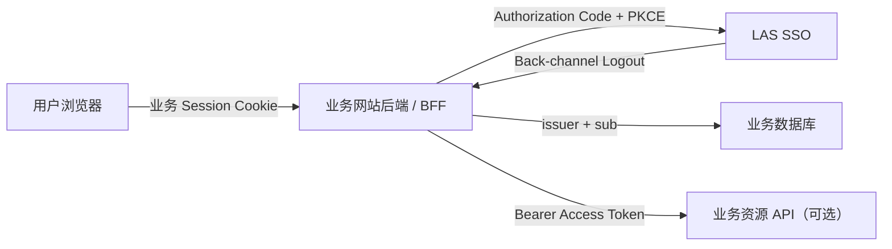
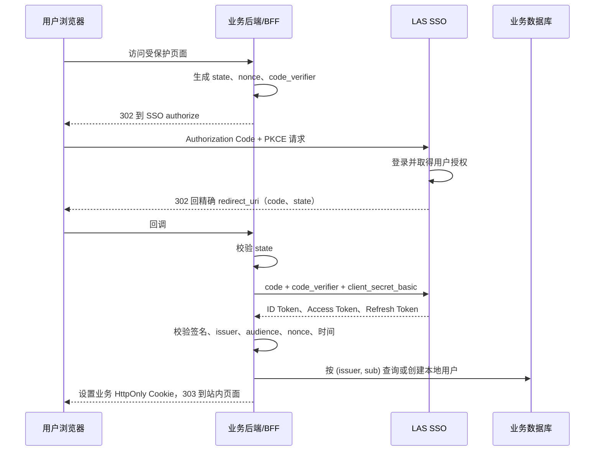

# LAS SSO 业务网站接入实施指南

- 文档状态：当前实现对应的接入指南
- 适用对象：LAS 自营网站、经过人工审核的合作网站
- 协议：OpenID Connect（OIDC）Authorization Code + PKCE S256
- 推荐架构：服务端 Confidential Client / BFF
- 第一方专用说明：[LAS 第一方网站 SSO 接入指南](first-party-system-sso-integration-guide.md)
- 详细安全契约：[OIDC 与 BFF 接入契约](../architecture/oidc-and-bff-contract.md)

## 1. 推荐方案

业务网站应让自己的服务端负责 OIDC，浏览器只持有业务网站自己的 `HttpOnly` Session Cookie。Access Token、Refresh Token、ID Token 和客户端密钥都不得交给浏览器脚本。



这里的 BFF 不一定是独立服务：

- Spring Boot 网站可以直接由现有后端承担 BFF 职责；
- Nuxt 可以由 Nitro Server Routes 承担 BFF 职责；
- Django 可以直接使用服务端 OIDC 客户端库承担该职责；
- 前后端分离项目也可以在现有 API 网关或后端内实现，不要求额外部署一个服务。

### 1.1 当前支持范围

| 方案 | 当前是否支持 | 说明 |
|---|---|---|
| Spring Boot 服务端/BFF | 支持，推荐 | 仓库已有 starter 和参考应用 |
| Django、Node、Nuxt 服务端/BFF | 支持 | 按通用 OIDC 契约实现，当前没有现成适配包 |
| 传统服务端网站直接接入 | 支持 | 其后端本身就是 OIDC Relying Party |
| 纯浏览器 SPA 直接接入 | 暂不支持 | 当前管理员端只创建带密钥的 Confidential Client，不能把密钥放进浏览器 |
| 客户端凭据模式调用 API | 不支持 | 第一版未开放 Client Credentials |

## 2. SSO 与业务系统的边界

LAS SSO 只确认用户身份并管理统一登录状态。业务网站必须自行管理业务角色、封禁、白名单、Minecraft 绑定和内容权限。

业务系统识别用户时必须使用 `(issuer, sub)`：

```text
issuer = Discovery 返回的 issuer
sub    = OIDC 返回的不可变用户 UUID v7
```

不得使用用户名作为关联键。用户名大小写敏感且允许修改，只能用于展示；修改用户名后，`sub` 不变，本地用户映射也不得改变。

当前可申请的 scopes 固定为：

```text
openid profile
```

业务网站不会从 SSO Token 获得邮箱、SSO 管理员身份、Minecraft 信息或业务权限。

## 3. 接入前需要提交的信息

接入方应向 LAS 管理员提供：

1. 网站名称、运营主体、负责人和安全联系人；
2. 网站域名、隐私说明、数据用途和账号注销后的处理方式；
3. 建议的 `client_id`，例如 `partner-example-bff`；
4. 精确的登录回调地址；
5. 精确的退出回调地址；
6. Back-channel Logout 地址；
7. 申请的 scopes，当前通常为 `openid profile`；
8. 独立的资源 audience，例如 `urn:las:resource:partner-example`；
9. 开发、预发布、生产环境清单。

不同环境建议使用不同 `client_id`。生产地址必须使用 HTTPS；只有本地配置允许 `http://localhost` 或 `http://127.0.0.1`。所有 URI 都是精确匹配，不支持通配符、片段或任意跳转地址。

## 4. SSO 管理员登记客户端

管理员进入：

```text
/admin/clients
```

合作网站应登记为 `REVIEWED_PARTNER`，使首次授权和授权范围扩大时显示用户授权确认。LAS 自营网站才使用 `FIRST_PARTY`。

示例配置：

| 字段 | 示例 |
|---|---|
| 客户端 ID | `partner-example-bff` |
| 名称 | `Example 合作网站` |
| 类型 | `REVIEWED_PARTNER` |
| Redirect URI | `https://partner.example/login/oauth2/code/las-sso` |
| Post Logout URI | `https://partner.example/logged-out` |
| Back-channel URI | `https://partner.example/internal/oidc/backchannel-logout` |
| Scopes | `openid profile` |
| Resource audience | `urn:las:resource:partner-example` |

创建成功后，客户端密钥只显示一次。管理员应通过可信渠道交付，接入方应立即保存到部署 Secret；不得写入 Git、前端环境变量、网页源码或日志。

客户端密钥轮换会使旧密钥立即失效，应在维护窗口内完成：准备新 Secret、更新部署配置、重启业务后端、执行登录与刷新冒烟测试。

## 5. 业务系统配置

### 5.1 通用配置

业务系统只配置 Issuer，并通过 Discovery 获取实际协议端点：

```text
生产占位：https://auth.las.example
本地开发：http://127.0.0.1:9000
Discovery：<issuer>/.well-known/openid-configuration
```

通用客户端配置：

```yaml
issuer: https://auth.las.example
clientId: partner-example-bff
clientSecret: ${LAS_SSO_CLIENT_SECRET}
clientAuthenticationMethod: client_secret_basic
authorizationGrantType: authorization_code
redirectUri: https://partner.example/login/oauth2/code/las-sso
postLogoutRedirectUri: https://partner.example/logged-out
backchannelLogoutUri: https://partner.example/internal/oidc/backchannel-logout
expectedAudience: urn:las:resource:partner-example
scopes:
  - openid
  - profile
pkce: S256
clockSkewSeconds: 60
```

不得在代码里分别拼接 `/oauth2/authorize`、`/oauth2/token` 或 JWKS 地址；Discovery 返回值是唯一权威来源。Issuer 的 scheme、host、port 和 path 必须完全一致，`localhost` 与 `127.0.0.1` 也不能混用。

### 5.2 Spring Boot 接入

仓库当前提供：

- `las-sso-spring-boot-starter`：接入骨架；
- `las-sso-reference-bff`：端口 `8088` 的可运行参考应用。

starter 尚未发布到公共 Maven 仓库。跨仓库使用前，应先发布到 LAS 内部 Maven 仓库并固定版本，然后由业务项目添加依赖；不建议复制源码形成多个不可同步的版本。

发布后，业务项目的预期依赖形式为：

```kotlin
implementation("org.las:las-sso-spring-boot-starter:<固定版本>")
```

配置示例：

```yaml
spring:
  security:
    oauth2:
      client:
        registration:
          las-sso:
            provider: las-sso
            client-id: partner-example-bff
            client-secret: ${LAS_SSO_CLIENT_SECRET}
            client-authentication-method: client_secret_basic
            authorization-grant-type: authorization_code
            redirect-uri: "{baseUrl}/login/oauth2/code/{registrationId}"
            scope: openid,profile
        provider:
          las-sso:
            issuer-uri: https://auth.las.example

las:
  sso:
    client:
      registration-id: las-sso
      refresh-before-expiry: 60s
      post-logout-redirect-uri: "{baseUrl}/logged-out"
      logout-success-uri: /
      logout-state-ttl: 5m
```

starter 默认提供：

```text
GET  /api/auth/login
GET  /api/auth/session
POST /api/auth/logout
POST /api/auth/logout/global
GET  /logged-out
POST /internal/oidc/backchannel-logout
```

如果业务项目自己声明了 `SecurityFilterChain`，starter 不会覆盖它；业务项目必须自行配置 OAuth2 Login、PKCE、受保护路由、CSRF 和退出规则。

### 5.3 Django、Node 或 Nuxt 接入

应选择成熟且仍受维护的 OIDC/OAuth 2.0 库，不自行实现 JWT 解析、签名校验或 PKCE。无论框架如何，必须实现以下共同能力：

```text
login
callback
currentSession
requireLogin
logoutCurrent
logoutGlobal
backChannelLogout
refreshWithSingleFlight
jitProvision
```

Nuxt 项目推荐在 Nitro 服务端保存 Token，并向浏览器只暴露站内 Session API。`runtimeConfig.public` 只能放 Issuer、站内路由等公开信息，客户端密钥必须放在仅服务端可见的 `runtimeConfig` 中。

## 6. 登录与本地用户创建流程



回调处理必须按以下顺序执行：

1. 检查登录事务存在、未使用且未过期；
2. 常量时间比较 `state`；
3. 使用原始 `redirect_uri` 和 `code_verifier` 兑换 code；
4. 验证 ID Token 的签名、固定算法、`kid`、`iss`、`aud`、`azp`、`exp`、`iat` 和 `nonce`；
5. 把 `sub` 当作不透明稳定标识保存；
6. 在一个事务内执行 JIT Provisioning 和业务会话创建；
7. 原子消费登录事务并删除 `code_verifier`；
8. 只跳转到经过允许列表校验的站内 `returnTo`。

推荐的本地映射约束：

```sql
UNIQUE (issuer, subject)
```

首次出现的 `(issuer, sub)` 只能创建普通、无敏感权限用户。随后由业务系统自己的审批或权限规则赋权，绝不能因为 SSO 登录成功自动授予管理员、白名单等权限。

## 7. Token、会话与续期

当前约定：

| 对象 | 时长 |
|---|---:|
| Authorization Code | 2 分钟，单次使用 |
| ID Token | 始终以 Token 的 `exp` 为准；契约目标为 10 分钟 |
| Access Token | 15 分钟 |
| Refresh Token family | 首次授权后绝对 14 天，轮换但不顺延 |

业务浏览器 Cookie 只保存随机本地 Session ID，并至少设置：

```text
Secure; HttpOnly; SameSite=Lax
```

服务端会话至少关联 `issuer`、`sub`、`sid`、授权客户端、Access Token 到期时间和 Refresh Token。每个受保护请求都必须检查当前 Access Token 是否仍新鲜；到期前约 60 秒执行刷新。

Refresh Token 每次使用都会轮换。同一业务会话发生并发请求时只能有一个刷新操作：

- 单实例小网站可以先使用进程内 single-flight；
- 多实例部署必须使用 PostgreSQL 行锁、advisory lock 或等价的分布式协调；
- SSO 明确拒绝刷新时清除本地认证；
- SSO 暂时不可用时，本次受保护请求返回 `503`，不要误判为账号被封禁。

当前 Spring starter 的授权客户端、刷新锁、Back-channel 会话索引和 Logout Token 重放缓存仍只覆盖单 JVM，适合本地样例或明确的单实例阶段。合作网站生产接入前应补充持久化；即使计划只部署一个实例，也需要考虑进程重启后的会话行为。

## 8. 退出流程

### 8.1 只退出当前应用

业务网站先撤销自己的本地会话并清除 Cookie，然后尽力撤销对应的远程授权。SSO 主会话保持有效，所以用户再次进入该网站时可能不需要重新输入密码。

Spring starter 端点：

```text
POST /api/auth/logout
```

### 8.2 退出全部应用

业务网站通过顶层导航进入 Discovery 声明的 `end_session_endpoint`，携带服务端保存的 `id_token_hint`、精确登记的 `post_logout_redirect_uri` 和一次性 `state`。SSO 随后撤销主会话和相关授权，并向已接入网站发送 Back-channel Logout。

Spring starter 端点：

```text
POST /api/auth/logout/global
GET  /logged-out?state=...
```

### 8.3 Back-channel Logout

接入方必须提供一个不依赖浏览器 Cookie 的后端端点：

```http
POST /internal/oidc/backchannel-logout
Content-Type: application/x-www-form-urlencoded

logout_token=<signed JWT>
```

该端点必须验证 `typ=logout+jwt`、RS256 签名、Issuer、Audience、时间、`jti`、`events` 和 `sid/sub`，然后按 `(issuer, sid)` 撤销本地会话。重复发送同一个有效 Token 必须保持幂等。

## 9. 前端与 API 约定

前端建议只调用业务站点自己的接口：

```text
GET  /api/auth/login
GET  /api/auth/session
POST /api/auth/logout
POST /api/auth/logout/global
```

会话查询示例：

```json
{
  "authenticated": true,
  "user": {
    "sub": "019fb42f-5f16-7c31-8ce0-9e54f7441ff0",
    "username": "ExampleUser",
    "businessPermissions": {}
  }
}
```

`businessPermissions` 来源于业务系统自身数据库，不是 SSO Claims。

如果后端需要使用 Access Token 调用资源 API，资源服务器必须验证签名、Issuer、自己的 audience、时间和 scope。ID Token 不能作为 API Bearer Token。

## 10. 联调顺序

建议依次完成：

1. 访问 Discovery，确认返回的 `issuer` 与配置完全相同；
2. 从未登录状态访问受保护页面，确认跳转到 LAS SSO；
3. 完成登录和合作方 consent，确认精确回调成功；
4. 验证业务数据库按 `(issuer, sub)` 只创建一个本地用户；
5. 修改 SSO 用户名后重新登录，确认仍关联原本地用户；
6. 验证浏览器看不到任何 Token 和客户端密钥；
7. 等待或模拟 Access Token 到期，验证只发生一次 Refresh Token 轮换；
8. 验证“退出当前应用”不会退出 SSO；
9. 验证“退出全部应用”会使所有已接入应用退出；
10. 验证 Back-channel Logout 重复通知保持幂等；
11. 禁用客户端，确认新登录、刷新和已有授权均失效；
12. 模拟 SSO 网络故障，确认系统返回可区分的临时不可用状态；
13. 重启业务后端，确认生产持久化策略符合预期；
14. 检查日志，确认没有 code、Token、客户端密钥或完整 Cookie。

## 11. 上线检查表

- [ ] 合作网站已经人工审核；
- [ ] 每个环境使用独立客户端；
- [ ] 所有生产 URI 使用 HTTPS 且精确登记；
- [ ] 客户端密钥来自部署 Secret；
- [ ] 使用 Authorization Code + PKCE S256；
- [ ] 固定验证 RS256、Issuer、Audience、Nonce 和时间；
- [ ] 本地用户对 `(issuer, sub)` 有唯一约束；
- [ ] 业务权限不依赖用户名或未经定义的 Token Claim；
- [ ] 浏览器不保存或读取 OAuth/OIDC Token；
- [ ] Refresh Token 已轮换且并发刷新有 single-flight；
- [ ] 当前应用退出、全局退出和 Back-channel Logout 均已验证；
- [ ] 会话、授权客户端和重放缓存满足部署实例数与重启要求；
- [ ] 已配置 TLS、Secret 轮换、审计、告警和时间同步；
- [ ] 已通过登录、续期、撤销、禁用客户端和故障演练。

## 12. 当前实施建议

对于新的小型合作网站，建议按以下阶段推进：

1. 先使用单实例服务端/BFF 和独立 PostgreSQL 会话存储完成联调；
2. Spring Boot 项目优先复用 starter，其他框架按本指南封装自己的适配层；
3. 在正式开放合作方前，把 Spring starter 发布到内部 Maven 仓库并实现业务端授权客户端、Back-channel 索引和重放缓存持久化；
4. 纯 SPA/Public Client 作为后续独立设计，不复用当前 Confidential Client 配置。

相关实现与规格：

- [OIDC 与 BFF 接入契约](../architecture/oidc-and-bff-contract.md)
- [API 契约](../architecture/api-contract.md)
- [身份与数据模型](../architecture/identity-and-data-model.md)
- [Spring Boot starter 说明](../../las-sso-server/las-sso-spring-boot-starter/README.md)
- [Spring Boot 参考 BFF](../../las-sso-server/las-sso-reference-bff)
