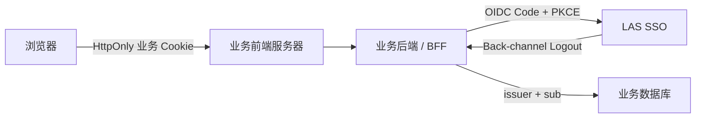

# LAS 第一方网站 SSO 接入指南

- 文档状态：当前第一方接入实施指南
- 适用对象：由 LAS 自己运营和控制部署的业务网站
- 推荐架构：服务端 Confidential Client / BFF
- 通用流程：[业务网站接入实施指南](business-system-sso-integration-guide.md)

## 1. 第一方客户端的定义

第一方网站是由 LAS 直接运营、能够统一执行安全策略并由 LAS 控制客户端密钥和部署流程的网站，例如 LASLOG 和 AlienCommon。

第一方身份不表示网站可以读取 SSO 数据库，也不表示网站可以获得 SSO 管理员身份。所有业务系统仍然只能通过 OIDC 确认用户身份，并在自己的数据库中管理业务权限。

第一方与合作方的主要区别：

| 项目 | LAS 第一方网站 | 审核合作网站 |
|---|---|---|
| 客户端类型 | `FIRST_PARTY` | `REVIEWED_PARTNER` |
| 用户授权确认 | 默认不显示 | 首次授权及范围扩大时显示 |
| 运营与部署 | LAS 控制 | 合作方控制，LAS 审核 |
| 客户端密钥 | LAS 内部 Secret 管理 | 通过可信渠道一次性交付 |
| 身份主键 | `(issuer, sub)` | `(issuer, sub)` |
| scopes | `openid profile` | `openid profile` |
| 业务权限 | 业务系统自行管理 | 业务系统自行管理 |

即使是第一方网站，也禁止复用另一个网站的 `client_id` 或 Client Secret。每个业务系统和每个环境都使用独立客户端。

2026-10-05已提供可辨识本地server/starter开发组合0.1.0-dev.20261005.1，公共授权prompt/max_age扩展/签名auth_time读取与七字段资格stateEpoch契约，坐标/sourcefingerprint/锁/Jarhash/两metadata实际消费见[English](development-delivery-2026-10-05.md)／[中文](../zh-CN/integration/development-delivery-2026-10-05.md)。此组合不实现业务pending操作/十五分钟门禁或缓存恢复屏障，消费方须独立接入验收；未托管productionrelease。

## 2. 推荐部署结构



可以按项目技术栈落地：

- LASLOG：Nuxt 页面由 Nitro Server Routes 或 Spring Boot 后端承担 BFF；如果业务 API 已全部由 Spring Boot 提供，优先让 Spring Boot 统一管理 OIDC 和业务会话；
- AlienCommon：Django 后端直接承担 OIDC Relying Party/BFF；
- 传统 Spring MVC/Thymeleaf 网站：现有 Spring Boot 应用本身就是 BFF，不需要增加独立服务；
- 纯静态前端：当前不能直接成为 LAS SSO 客户端，需要增加服务端会话层。

## 3. 接入前确定的信息

每个第一方网站需要确定：

```text
业务系统名称
开发、预发布、生产环境
client_id
Redirect URI
Post Logout URI
Back-channel Logout URI
Resource audience
业务 Session Cookie 名称
负责人与故障联系人
```

命名建议：

| 项目 | Client ID | Audience |
|---|---|---|
| LASLOG | `laslog-bff` | `urn:las:resource:laslog` |
| AlienCommon | `aliencommon-bff` | `urn:las:resource:aliencommon` |
| 其他第一方系统 | `<system>-bff` | `urn:las:resource:<system>` |

开发、预发布和生产应使用不同 Client ID，例如：

```text
laslog-local-bff
laslog-staging-bff
laslog-bff
```

## 4. 在 SSO 中登记

SSO 管理员进入：

```text
/admin/clients
```

创建客户端时：

1. 类型选择 `FIRST_PARTY`；
2. scopes 固定填写 `openid profile`；
3. Redirect、Post Logout 和 Back-channel URI 使用精确地址；
4. 为业务系统设置独立 Resource audience；
5. 填写可审计的创建原因；
6. 保存只显示一次的 Client Secret。

示例：

| 字段 | LASLOG 生产示例 |
|---|---|
| Client ID | `laslog-bff` |
| 类型 | `FIRST_PARTY` |
| Redirect URI | `https://log.las.example/login/oauth2/code/las-sso` |
| Post Logout URI | `https://log.las.example/logged-out` |
| Back-channel URI | `https://log.las.example/internal/oidc/backchannel-logout` |
| Scopes | `openid profile` |
| Audience | `urn:las:resource:laslog` |

生产客户端只登记 HTTPS。开发阶段可以使用精确的 `localhost` 或 `127.0.0.1` 地址，但一次登录流程不能在两者之间切换。

## 5. 业务系统实现

### 5.1 服务端配置

业务后端必须配置：

```yaml
issuer: https://auth.las.example
clientId: laslog-bff
clientSecret: ${LAS_SSO_CLIENT_SECRET}
clientAuthenticationMethod: client_secret_basic
authorizationGrantType: authorization_code
redirectUri: https://log.las.example/login/oauth2/code/las-sso
postLogoutRedirectUri: https://log.las.example/logged-out
backchannelLogoutUri: https://log.las.example/internal/oidc/backchannel-logout
expectedAudience: urn:las:resource:laslog
scopes: [openid, profile]
pkce: S256
```

只配置 Issuer，通过 Discovery 获取授权、Token、JWKS、UserInfo、撤销和结束会话端点。不要在业务代码中分别硬编码 SSO 端点。

Spring Boot 项目优先使用仓库中的 `las-sso-spring-boot-starter`。使用方式、当前端点和单实例限制见[业务网站接入实施指南](business-system-sso-integration-guide.md#52-spring-boot-接入)。

### 5.2 浏览器端

浏览器只调用业务网站自己的端点：

```text
GET  /api/auth/login
GET  /api/auth/session
POST /api/auth/logout
POST /api/auth/logout/global
```

浏览器不得接收或保存：

```text
Client Secret
Authorization Code
Access Token
Refresh Token
ID Token
```

业务 Cookie 至少使用 `Secure; HttpOnly; SameSite=Lax`，不同第一方网站使用不同 Cookie 名称和 host 范围。

### 5.3 本地用户映射

业务数据库建立唯一约束：

```sql
UNIQUE (issuer, subject)
```

登录回调中执行：

1. 校验 OIDC 响应和 ID Token；
2. 按 `(issuer, sub)` 查找本地用户；
3. 不存在时创建无敏感权限的普通用户；
4. 更新可变的用户名和公开资料快照；
5. 加载业务系统自己的角色、白名单或内容权限；
6. 创建业务 Session。

用户名修改不能创建第二个业务账号，也不能影响已有权限。LASLOG 的 Minecraft 绑定、服务器白名单、封禁和角色仍存放在 LASLOG；AlienCommon 的稿件权限仍存放在 AlienCommon。

## 6. 登录、刷新和退出

### 6.1 登录

业务后端生成 `state`、`nonce` 和 PKCE `code_verifier`，通过顶层页面跳转进入 SSO。若 SSO 会话仍有效，第一方网站通常可以直接完成授权返回，不再次显示登录或 consent 页面。

### 6.2 刷新

Access Token 当前为 15 分钟。业务后端在到期前约 60 秒使用 Refresh Token 刷新，并在每个受保护请求检查 `auth_fresh_until`。

同一业务 Session 的并发刷新必须合并：单实例阶段可以使用进程内 single-flight，多实例必须改为数据库锁或其他分布式协调。

### 6.3 退出当前网站

先撤销本地业务 Session，再尽力撤销对应授权。不要结束 SSO 主会话，因此用户进入其他 LAS 网站时仍保持登录。

### 6.4 退出全部网站

通过 Discovery 的 `end_session_endpoint` 发起 RP-Initiated Logout。SSO 撤销主会话和授权，并通过 Back-channel Logout 通知所有已访问的业务网站。

第一方网站必须实现幂等的 Back-channel Logout，根据 `(issuer, sid)` 撤销本地业务 Session。

## 7. 第一方内部信任边界

第一方网站可以免 consent，但不能放宽以下校验：

- 仍必须使用 Authorization Code + PKCE S256；
- 仍必须校验 `state`、`nonce`、Issuer、Audience、签名和时间；
- 仍不能把 Client Secret 或 Token 放入浏览器；
- 仍不能直接读取或联表 SSO 数据库；
- 仍不能信任用户名作为账号主键；
- 仍不能把 SSO 登录等同于业务管理员权限；
- 仍必须支持客户端禁用、密钥轮换和全局退出。

业务系统调用其他 LAS API 时，应使用针对目标 Resource Server 的 Access Token 和 audience 校验，不能转发 ID Token 代替 API 凭据。

## 8. 联调验收

- [ ] Discovery 的 `issuer` 与配置完全一致；
- [ ] 未登录访问会跳转 SSO；
- [ ] 已登录 SSO 时可直接进入第一方网站；
- [ ] 回调地址、`state`、`nonce` 和 PKCE 校验正常；
- [ ] `(issuer, sub)` 只创建一个本地用户；
- [ ] 修改用户名后仍映射到原用户；
- [ ] 业务权限只来自业务数据库；
- [ ] 浏览器中没有 Token 和 Client Secret；
- [ ] Access Token 到期后只执行一次刷新；
- [ ] 退出当前网站不会退出其他网站；
- [ ] 全局退出会清理所有第一方网站会话；
- [ ] Back-channel Logout 重复发送保持幂等；
- [ ] 禁用客户端后登录和刷新均失败；
- [ ] 轮换 Secret 后旧 Secret 失效；
- [ ] 业务后端重启后的会话行为符合部署方案。

## 9. 当前建议

1. LASLOG Spring Boot 后端先接入现有 starter 和参考 BFF，Nuxt 只消费同源 Session API；
2. AlienCommon 使用 Django 服务端 OIDC 库实现相同端点语义；
3. 两个系统都先按单实例实现，但把 Session 和授权客户端持久化列为正式上线门禁；
4. 完成两套真实业务系统黑盒测试后，再把 starter 发布为带版本的内部 SDK；
5. 后续第一方网站复制接入配置和契约测试，不复制认证实现源码。
