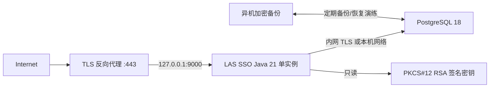

# LAS SSO 部署指南

当前按依赖排序的任务入口：[正式生产上线计划](../zh-CN/implementation/production-launch-plan.md)／[English](../implementation/production-launch-plan.md)。该计划从`.7`开发交付到候选发行、目标部署和有限开放，列明模块/步骤/证据；本指南提供部署操作，执行结果另行记录。

- 文档状态：当前仓库的可执行部署步骤
- 推荐基线：单实例 Spring Boot + PostgreSQL + TLS 反向代理
- 详细运维策略：[部署与运维手册](operations-runbook.md)
- 上线门禁：[实施准备度](../implementation/implementation-readiness.md#7-生产上线门禁)

2026-10-09已确认首发：**单机Docker Compose、同机Nginx、初期无CDN、只开放SSO账号站**。优先使用[Docker输入矩阵](../zh-CN/operations/docker-compose-deployment.md)／[English](docker-compose-deployment.md)和[可执行容器步骤](../../las-sso-server/deploy/docker/README.zh-CN.md)。下文JAR/systemd是独立host部署参考，不能复制其loopback配置到容器。实际域名、容量、RPO/RTO和通知方式仍待定。

## 1. 当前部署能力与限制

恢复旧库后可用[epoch维护脚本](../zh-CN/operations/restore-epoch-barrier.md)进行预开放屏障；.20261006.1隔离pgdumprestore/持久key/交互命令已验，仍不等生产backup、代理摘流量或consumercache验收。

当前仓库可以构建可执行 Spring Boot JAR，并使用 PostgreSQL 持久化账号、OIDC 授权和 SSO HTTP Session。

需要明确：

- `las-sso-server/compose.yml` 只用于本地启动 PostgreSQL；
- `las-sso-server/deploy/docker/`提供首发Dockerfile/Compose及维护/代理模板，已本地隔离验收，目标环境仍需验；
- 本指南下文保留“可执行JAR + PostgreSQL + 反向代理”的host/systemd路径；
- `local` profile 使用临时 RSA 密钥、HTTP Cookie 和示例客户端，严禁用于公网生产；
- 文档完成不代表已经通过全部[生产上线门禁](../implementation/implementation-readiness.md#7-生产上线门禁)。

## 2. 部署拓扑



单实例是已确认初期拓扑，用户量/并发/资源上限须目标实测，旧约1,000用户假设不是本轮选定输入。应用和PostgreSQL不直接暴露公网，仅反向代理提供HTTPS。

## 3. 前置条件

- 64 位 Java 21；
- PostgreSQL 18；
- TLS 反向代理，例如 Nginx、Caddy 或等价网关；
- 正式域名，例如 `auth.example.com`；
- 有效 TLS 证书；
- 可执行 Gradle Wrapper 的构建环境；
- 独立的低权限系统账号和数据库账号；
- 数据库、签名私钥与 Secret 的异机备份位置；
- 正确的 NTP/系统时间同步。

推荐路径示例：

```text
/opt/las-sso/las-sso-server.jar
/etc/las-sso/las-sso.env
/etc/las-sso/keys/las-sso-signing.p12
/var/lib/postgresql/...
```

应用系统账号只需要读取 JAR、环境配置和签名私钥；不应拥有数据库超级用户、反向代理配置或私钥目录写权限。

## 4. 准备 PostgreSQL

以 PostgreSQL 管理员进入 `psql`：

```sql
CREATE ROLE las_sso LOGIN;
\password las_sso
CREATE DATABASE las_sso OWNER las_sso ENCODING 'UTF8';
```

生产数据库要求：

- 只允许 SSO 主机通过内网或本机访问；
- 不开放公网 `5432`；
- 应用使用独立账号，不使用 `postgres` 超级用户；
- 连接要求 TLS 时，在 JDBC URL 中配置与证书策略匹配的 `sslmode`；
- 备份账号与应用账号分离；
- 先确定备份、保留和恢复演练方案再上线。

JDBC URL 示例：

```text
jdbc:postgresql://127.0.0.1:5432/las_sso
```

## 5. 生成生产签名密钥

非 `local`、非 `test` profile 必须加载持久化 PKCS#12 RSA 密钥。使用 JDK `keytool` 在受控环境生成：

```powershell
keytool -genkeypair `
  -alias las-sso-signing `
  -keyalg RSA `
  -keysize 3072 `
  -sigalg SHA256withRSA `
  -validity 3650 `
  -storetype PKCS12 `
  -keystore las-sso-signing.p12 `
  -dname "CN=LAS SSO Signing"
```

让 `keytool` 交互式读取密码，避免把密码写入命令行历史。部署时同时设置：

```text
LAS_SSO_SIGNING_KEY_PATH=/etc/las-sso/keys/las-sso-signing.p12
LAS_SSO_SIGNING_KEY_ALIAS=las-sso-signing
LAS_SSO_SIGNING_KEY_ID=las-prod-2026-01
LAS_SSO_SIGNING_KEY_PASSWORD=<Secret>
```

`key-id` 必须稳定且唯一。私钥文件只允许 SSO 系统账号读取，并制作加密离线备份；密钥库密码与备份分开保存。

当前实现一次加载一把签名私钥。正式执行无中断双 key 轮换前，需要补充同时发布新旧 JWKS 的能力或安排与所有业务系统协调的维护方案。

## 6. 生成其他 Secret

至少分别生成以下三个相互独立的高熵值：

```text
LAS_SSO_RECOVERY_PEPPER
LAS_SSO_TRANSIENT_SECURITY_PEPPER
LAS_SSO_CAPTCHA_HMAC_SECRET
```

可以在 PowerShell 中生成 48 字节随机值：

```powershell
$bytes = [byte[]]::new(48)
[Security.Cryptography.RandomNumberGenerator]::Fill($bytes)
[Convert]::ToBase64String($bytes)
```

每个用途分别执行一次。不要复用数据库密码、签名密钥密码、客户端 Secret 或其他 pepper。

## 7. 构建与验证

在可信构建机进入 `las-sso-server`：

```powershell
.\gradlew.bat build -PrequireDatabaseTests=true --rerun-tasks --no-daemon --console=plain
```

注意：PostgreSQL 集成测试依赖 Docker/Testcontainers；Docker 不可用时会跳过，不能把跳过视为验证通过。

构建产物当前为：

```text
build/libs/las-sso-server-0.1.0-SNAPSHOT.jar
```

部署前记录：

- Git commit；
- JAR SHA-256；
- Java、Spring Boot、Gradle 和 PostgreSQL 版本；
- 测试数量、失败数与跳过数；
- 依赖漏洞扫描结果；
- 数据库备份编号。

## 8. 生产配置

当前实现实际读取以下环境变量：

```dotenv
SPRING_PROFILES_ACTIVE=production
SPRING_DATASOURCE_URL=jdbc:postgresql://127.0.0.1:5432/las_sso
SPRING_DATASOURCE_USERNAME=las_sso
SPRING_DATASOURCE_PASSWORD=<Secret>

LAS_SSO_ISSUER=https://auth.example.com
LAS_SSO_SIGNING_KEY_PATH=/etc/las-sso/keys/las-sso-signing.p12
LAS_SSO_SIGNING_KEY_PASSWORD=<Secret>
LAS_SSO_SIGNING_KEY_ALIAS=las-sso-signing
LAS_SSO_SIGNING_KEY_ID=las-prod-2026-01
LAS_SSO_RECOVERY_PEPPER=<独立 Secret>
LAS_SSO_TRANSIENT_SECURITY_PEPPER=<独立 Secret>
LAS_SSO_CAPTCHA_HMAC_SECRET=<独立 Secret>

SERVER_PORT=9000
SERVER_FORWARD_HEADERS_STRATEGY=framework
SERVER_SERVLET_SESSION_COOKIE_SECURE=true
```

重要规则：

- `LAS_SSO_ISSUER` 一旦投入使用就是身份命名空间的一部分，不得随意改变；
- Issuer 必须与外部实际 HTTPS 地址以及 Discovery 返回值完全相等；
- 正式 Issuer 不能使用 `.example`、HTTP、`localhost` 或 `127.0.0.1`；
- 当前数据库变量是 Spring Boot 的 `SPRING_DATASOURCE_*`，不是旧设计稿中的 `LAS_SSO_DATABASE_*`；
- 环境配置文件权限应限制为 SSO 系统账号可读，例如 Linux `0600`；
- 不把生产值提交到 Git、镜像、Compose 或终端日志。

P02已实现profile/Issuer/context/key/Secret/Cookie/Flyway/epoch/admin/ACTIVE客户端启动校验；代理信任、公共CA、真实域名所有权、文件保管/备份/容量仍需运维验证，不能只凭启动成功开放。

## 9. 首次启动与迁移

空库不得先启动Web；保持入口关闭，先以相同精确JAR/key/秘密、迁移角色运行内嵌Flyway离线命令：

```powershell
java -jar $ServerJar --spring.profiles.active=production --spring.main.web-application-type=none --las.sso.maintenance.command=database-migrate --las.sso.scheduling.enabled=false --spring.session.jdbc.cleanup-cron=- --las.sso.monitoring.enabled=false
```

观察日志，确认：

```text
PostgreSQL 连接成功
Flyway migrations 全部成功
签名 PKCS#12 加载成功
Database migrations validated; no HTTP listener or application jobs started.
```

接着执行第10节隐藏bootstrap；完成后才以运行角色启动Web、验证健康。启用monitoring时health位于私有9091，否则9000：

```powershell
Invoke-RestMethod http://127.0.0.1:9000/actuator/health/liveness
Invoke-RestMethod http://127.0.0.1:9000/actuator/health/readiness
```

预期 `status` 为 `UP`。当前readiness组包含`readinessState,db`，数据库中断必须503、同库恢复后200；liveness不绑定DB。2026-10-06 .5真实stop/start已验，见[English](capacity-readiness-2026-10-06.md)／[中文](../zh-CN/operations/capacity-readiness-2026-10-06.md)。生产配置与启动门禁仍需另核；当前health详情never，只粗status。

## 10. 初始化唯一管理员

隔离真实WindowsPTY/Edge维护闭环（空库bootstrap/firstchange/reset/旧状态拒）已验，见[中文](../zh-CN/operations/administrator-maintenance-acceptance.md)／[English](administrator-maintenance-acceptance.md)。生产首次上线仍按精确制品/停writer/真实keySecret和离线恢复码保管步骤执行。

迁移完成、入口关闭且无Web写入者时，用同一生产key/秘密和维护数据库角色执行：

```powershell
.\scripts\bootstrap-admin.ps1 -Username InitialAdmin -Profile production -JarPath $ServerJar -ExpectedSha256 $ServerJarSha256
```

脚本交互式隐藏读取临时密码。完成后：

`$ServerJar` 和 `$ServerJarSha256` 必须来自选定交付，不能自动选择目录最新版本；缺失/摘要不符不启动 Java。reset 同样接受这两个参数，见[维护制品说明](../zh-CN/operations/maintenance-artifact-selection.md)。

1. 启动 Web 应用；
2. 管理员首次登录；
3. 立即修改临时密码；
4. 生成并离线保存管理员恢复码；
5. 确认数据库中只有一个 SSO 管理员；
6. 登记第一方业务系统客户端；
7. 不记录临时密码、恢复码或客户端 Secret 明文。

如果服务器没有 PowerShell，可以使用相同 JAR 执行维护命令：

```text
java -jar las-sso-server.jar
  --spring.main.web-application-type=none
  --spring.profiles.active=production
  --las.sso.maintenance.command=admin-bootstrap
  --las.sso.scheduling.enabled=false
  --spring.session.jdbc.cleanup-cron=-
  --las.sso.monitoring.enabled=false
  --username=InitialAdmin
```

实际执行时放在一行；密码仍由程序交互读取，不作为命令参数。

## 11. 反向代理

2026-10-06隔离真实Nginx/TLS验证发现只覆盖X-Forwarded-Host/Proto/For不足：客户端Forwarded和Prefix仍可扰乱callback。下示例已清alternate头，仓库提供[完整include](../../las-sso-server/deploy/nginx/las-forwarding.conf)，每个proxying location须完整设置，否则Nginx不继承parent整组。保持单literalcanonicalserver_name，另配unknownHost default拒与固定HTTPS redirect。来源及参考BFF `https` profile：[中文验收](../zh-CN/operations/tls-proxy-acceptance.md)／[English](tls-proxy-acceptance.md)。多级CDN/prefix/prod域名证书firewall另验，framework本身不验证代理来源。

Nginx 基线示例：

```nginx
server {
    listen 443 ssl;
    server_name auth.example.com;

    ssl_certificate     /etc/letsencrypt/live/auth.example.com/fullchain.pem;
    ssl_certificate_key /etc/letsencrypt/live/auth.example.com/privkey.pem;

    add_header Strict-Transport-Security "max-age=31536000; includeSubDomains" always;

    location / {
        proxy_pass http://127.0.0.1:9000;
        proxy_http_version 1.1;
        # Only this single canonical host is valid; client forwarding metadata is not trusted.
        proxy_set_header Forwarded "";
        proxy_set_header X-Forwarded-Prefix "";
        proxy_set_header X-Forwarded-Ssl "";
        proxy_set_header X-Forwarded-Server "";
        proxy_set_header Host $server_name;
        proxy_set_header X-Forwarded-Host $server_name;
        proxy_set_header X-Forwarded-Proto https;
        proxy_set_header X-Forwarded-Port 443;
        proxy_set_header X-Real-IP $remote_addr;
        proxy_set_header X-Forwarded-For $remote_addr;
    }

    location /actuator/ {
        allow 127.0.0.1;
        deny all;
        proxy_pass http://127.0.0.1:9000;
        proxy_set_header Forwarded "";
        proxy_set_header X-Forwarded-Prefix "";
        proxy_set_header X-Forwarded-Ssl "";
        proxy_set_header X-Forwarded-Server "";
        proxy_set_header Host $server_name;
        proxy_set_header X-Forwarded-Host $server_name;
        proxy_set_header X-Forwarded-Proto https;
        proxy_set_header X-Forwarded-Port 443;
        proxy_set_header X-Forwarded-For $remote_addr;
        proxy_set_header X-Real-IP $remote_addr;
    }
}
```

同时满足：

- 应用端口 `9000` 只监听本机或由防火墙限制为反向代理可访问；
- 不允许公网客户端绕过代理直连应用；
- 只信任受控反向代理提供的 Forwarded headers；
- HTTP 强制跳转 HTTPS；
- 上传和请求体限制保持较小；
- 访问日志不记录 Cookie、Authorization header、Token 或请求体秘密。

如果需要让 Spring Boot 明确只监听本机，可额外设置：

```text
SERVER_ADDRESS=127.0.0.1
```

## 12. systemd 服务示例

可选私有监控由[monitoringprofile与独立凭据](monitoring-and-alerting.md)／[中文](../zh-CN/operations/monitoring-and-alerting.md)提供。启用后management9091默认loopback，health与Prometheus位于管理listener；不得从publicNginx代理。供`LAS_SSO_MONITORING_PASSWORD_HASH`及collectorrawpasswordfile，不能复用OIDCclient/humanSession；跨host采集另配validatedTLS/firewall。实际指标、Prometheus/Alertmanager/Grafana输入和告警覆盖见该记录。

```ini
[Unit]
Description=LAS SSO
After=network-online.target postgresql.service
Wants=network-online.target

[Service]
Type=simple
User=las-sso
Group=las-sso
WorkingDirectory=/opt/las-sso
EnvironmentFile=/etc/las-sso/las-sso.env
ExecStart=/usr/bin/java -jar /opt/las-sso/las-sso-server.jar
Restart=on-failure
RestartSec=5s
SuccessExitStatus=143
NoNewPrivileges=true
PrivateTmp=true
ProtectSystem=strict
ProtectHome=true
ReadOnlyPaths=/etc/las-sso/keys

[Install]
WantedBy=multi-user.target
```

启用并查看日志：

```bash
sudo systemctl daemon-reload
sudo systemctl enable --now las-sso
sudo systemctl status las-sso
sudo journalctl -u las-sso -f
```

如果 JAR、日志或临时目录布局不同，应在最小范围内配置 `ReadWritePaths`，不要取消全部 systemd 沙箱保护。

## 13. 上线前冒烟测试

按顺序验证：

1. `https://auth.example.com/.well-known/openid-configuration` 可访问；
2. Discovery 的 `issuer` 与 `LAS_SSO_ISSUER` 完全一致；
3. JWKS 可访问且 `kid` 是预期生产值；
4. Cookie 含 `Secure`、`HttpOnly` 和 `SameSite=Lax`；
5. 注册、登录、个人中心和改密正常；
6. 管理员登录、客户端列表和审计页正常；
7. 每个实际开放BFF完成Code+PKCE登录（SSO账号站首发可无消费方）；
8. 开放消费方验Access Token刷新/轮换；
9. 开放消费方验当前应用退出不影响其他业务会话；
10. 开放消费方验全局退出/Back-channel清理；
11. SSO 进程重启后仍保持有效 SSO Session；
12. 数据库临时不可用时 readiness 失败且恢复后正常；
13. 日志中没有密码、恢复码、Client Secret、Token 或完整 Cookie。

## 14. 备份

上线前至少建立：

- PostgreSQL按已确认RPO安排加密定时备份（频率待定）；
- 备份文件异机保存；
- 签名私钥和 `kid` 的加密离线备份；
- 数据库 Secret 和签名密钥密码的分离保管；
- 备份校验和、数据库版本、schema 版本和时间记录；
- 按负责人确定周期隔离恢复演练，并测RPO/RTO。

示例逻辑备份：

```bash
pg_dump --format=custom --file=las_sso_YYYYMMDD.dump las_sso
sha256sum las_sso_YYYYMMDD.dump
```

不要把命令示例直接视为完整备份方案；生产环境还需要凭据保护、加密、异机传输、保留和自动验证。

从旧备份灾难恢复时，必须执行[恢复即全局安全重置](operations-runbook.md#84-恢复验收)：使全部旧 Session、Authorization 和 Refresh Token 失效，轮换安全 epoch/签名 key，并要求所有用户重新登录。

## 15. 升级与回滚

发布前：

1. 运行完整测试和依赖安全扫描；
2. 备份数据库并验证备份可读取；
3. 检查 Flyway migration；
4. 确认旧版本能否读取升级后的 schema；
5. 安排维护窗口；
6. 记录当前 JAR、Git commit、key ID 和客户端配置版本。

发布顺序：

```text
摘除流量 → 备份 → 部署 JAR → Flyway → readiness
→ Discovery/JWKS → 管理员登录 → BFF 登录/刷新/退出 → 恢复流量
```

Flyway不自动反向执行；仅已验schema兼容才允许回退JAR，生产门禁会拒未知未来迁移。旧快照恢复必须新epoch/key和全局安全重置，不能只回JAR。破坏性变更用expand/migrate/contract多阶段发布。

## 16. 故障处理摘要

| 故障 | 处理原则 |
|---|---|
| PostgreSQL 不可用 | readiness 失败；停止新登录、刷新和管理写入 |
| 签名密钥不可读 | 应用启动失败，不生成临时生产密钥 |
| SSO 暂时不可用 | BFF 在 freshness 边界后返回身份服务不可用，不伪装成封禁 |
| Back-channel 积压 | 保留 outbox 并重试，监控最老事件，不直接标记成功 |
| Client Secret 泄漏 | 轮换 Secret、撤销客户端授权、检查审计与日志 |
| 签名私钥泄漏 | 摘流量、换 key/kid、全局撤销并强制所有用户重新登录 |
| 管理员忘记密码 | 使用恢复码；否则维护窗口运行重置脚本 |

完整处理步骤见[部署与运维手册](operations-runbook.md#13-故障处理)。

## 17. 当前仍阻塞正式上线的事项

部署前必须重新审查[生产上线门禁](../implementation/implementation-readiness.md#7-生产上线门禁)，尤其包括：

- 正式域名、TLS、Issuer 和业务回调地址；
- 生产硬件上的密码哈希与资源耗尽测试；
- 反向代理、可信代理、Cookie、CSP 和 Secret 注入；
- PostgreSQL 备份恢复与全局安全重置演练；
- 各消费方实际上线前自己的BFF黑盒测试（SSO账号站首发不要求LASLOG/AlienCommon提前完成）；
- 全局退出和 Back-channel 重试验证；
- 浏览器 E2E、可访问性、日志秘密扫描和依赖漏洞处置；
- 签名 key 平滑轮换方案；
- 开放消费方的可靠已接受撤销恢复；初期单实例重启结束业务登录，多实例/跨重启保登录是独立任务。

在这些项目形成可复核证据前，只能称为测试或预发布部署，不能称为生产就绪。
