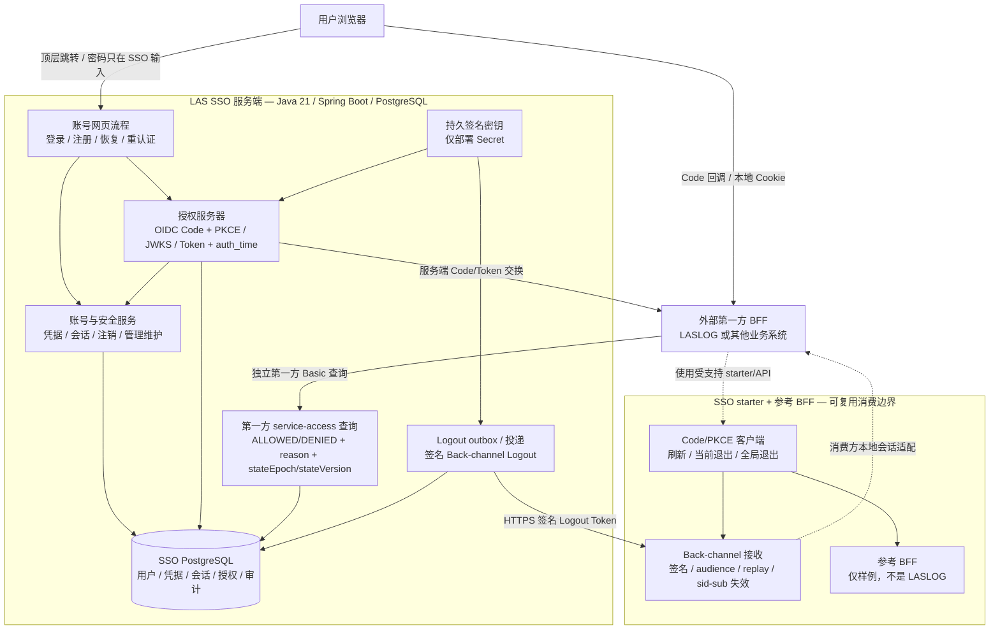

# LAS SSO 架构与 SSO 专属交付计划

- 日期：2026-10-02
- 最近范围更新：2026-10-07 .20261006.7 V15HMAC hint修refresh后global400、actualGrafana desktopmobileViewer/两套5分钟TLSmixed，505server193starter37ref=735零跳过。productiontransportoncall/remainingprobes/小时级rampsoak/historysizing/scanDAST与完整B1独立。
- 状态：SSO 专属架构和交付概览；实现与生产验收分别记录
- 英文对应：[SSO Architecture and SSO-Only Delivery Roadmap](../../architecture/sso-architecture-and-roadmap.md)
- 详细状态：[实现/问题/计划](../../implementation/status-issues-and-plan-2026-10-02.md)
- 接入需求：[LASLOG 交接](../../../../LASLOG/docs/zh-CN/sso-integration-handoff.md)

## 1. 范围与职责

当前[.7交付](../integration/development-delivery-2026-10-06-7.md)按[ADR-0011](../adr/0011-preserve-id-token-logout-hint-association.md)修refresh→globalhinthistory，验[actualGrafana/TLSmixed](../operations/grafana-mixed-load-2026-10-07.md)。HMAC-only不扩大ATRT或改因素permission/auth_time，每mode5subject9session45sfixtureAT/5minclosedloop非productionsizingsoak，旧段保历史。

当前[.20261006.6](../integration/development-delivery-2026-10-06-6.md)实现[SSO监控子集](../operations/monitoring-and-alerting.md)：独立无状态collectorcredential/separatemanagementport、固定countertimer/cacheDBgauge、3真alertrecovery与面板query已验。不加consumer凭据porttablebusinesspermission，不productionmonitor部署，原adminrestore未用.6重跑。

当前[.20261006.5](../integration/development-delivery-2026-10-06-5.md)修真实DBdownreadiness，并对[finalJAR重跑TLS/admin/restore](../operations/final-artifact-acceptance-2026-10-06.md)。[有界容量](../operations/capacity-readiness-2026-10-06.md)记录query/login/hash/JVMpool与DBfail/recover；领域metrics/privateexport/alerts和production sizing仍pending。保.4依赖基线并复扫，下方旧段保历史范围。

最新[.20261006.3](../integration/development-delivery-2026-10-06-3.md)以private网络/actualinclude/httpsprofile验[TLSproxyCookie边界](../operations/tls-proxy-acceptance.md)。是隔离transport证据，非正式certprovision/production信任链；下旧阶段按历史范围保留。

当前[.20261006.2](../integration/development-delivery-2026-10-06-2.md)修旧SSO凭据/Session撤销后Authorization续行，实际管理员维护按[记录范围](../operations/administrator-maintenance-acceptance.md)验收。下旧恢复/queue/browser证据保历史；production/晋升/expiry/operatoroffline/全部UI独立。

最新[交付.20261006.1](../integration/development-delivery-2026-10-06-1.md)／[ADR-0010](../adr/0010-executable-restore-epoch-barrier.md)落实expectedepoch/交互恢复、真实旧快照/newkey/旧Token拒。consumergeneration在本演练仅fixture，实际依赖方实现仍external，下方旧交付描述保历史。

当前[.4交付](../integration/development-delivery-2026-10-05-4.md)／[ADR-0009](../adr/0009-reference-bff-durable-token-revocation.md)为参考样例原sink持久加密任务，defaultStarter API/memory不变，已committedqueue重启恢复非业务Session持久/local退出outbox原子。

当前[交付.3](../integration/development-delivery-2026-10-05-3.md)按[ADR-0008](../adr/0008-retain-sid-revocations-before-local-registration.md)补默认Logout先到/并发登记保护、SPI不变、维护精确artifact/hash。下面.2保历史证据，不是当前fingerprint。

最新[交付.2](../integration/development-delivery-2026-10-05-2.md)记录UserInfo302/显式Bearer converter修复、15专项/639全量及默认/自有BFF真实Edge双会话/重认证/当前全局退出/Back-channel。下方旧阶段保留当时边界；本地HTTP闭环不关闭生产TLSproxy、消费高风险门禁或durableordering。

本文只管理 LAS SSO 服务端、`las-sso-spring-boot-starter` 和 `las-sso-reference-bff`。其他业务系统是外部依赖方，只作为消费端和验收输入出现，不属于本计划的实现范围。

SSO 负责：

- 稳定身份主体、凭据、密码认证和恢复；
- SSO 浏览器会话、OIDC 授权/Token 和账号生命周期；
- 第一方服务访问资格；
- SSO 退出信号、审计/安全事件、恢复与维护控制；
- 可复用 starter 契约和参考 BFF 行为。

SSO 不负责业务角色、邀请、项目、Minecraft 身份、白名单资格、服务器封禁或消费方的本地授权数据库。

## 2. SSO 架构图

## 3. SSO 当前→预期矩阵

| 项目 | 当前状况 | 预期状况 |
| --- | --- | --- |
| 身份/账号/密码 | 基础已实现，浏览器/生产验收待完成 | 稳定 UUID、凭据/恢复/生命周期，Token 不含业务权限 |
| SSO JDBC 会话 | 已实现并有 PostgreSQL 证据 | 期限、撤销、安全版本在支持拓扑中验证 |
| OIDC/Token | UserInfo修复/真EdgeCodeJWKSTokenUserInfo经受控HTTPSproxy已验 | 正式域名cert/proxytrusttopology及外consumer验收 |
| 密码重认证 |18 OIDC专项含revokedcookie续行，真browser challenge/password/auth_time及adminreset新登录已验 | 保留密码/browser/request证据，consumerpending/15m门禁仍external |
| Service-access | epochwire17/smallload保持，.20261006.1真实restore低counter/newepoch已验 | productionrestore/真实consumergenerationbarrier/旧inflight拒/proxyTLS容量观察SLA |
| 登录风控 | 原root/contextHTTP矩阵及.20261006.3真实HTTPSbrowser/proxyIPbudgetCAPTCHA/伪header与plainencoded拒已验 | prod20/50window/CDN多级IP归一/并发容量/全部UI |
| Logout | B3/B4回执及真实默认自有HTTPS current/global/CAtrustedBack-channel已验 | 自有durableadapter/crashrestartordering/正式production外consumer |
| Starter自有链 | 公共组合/B5＋trustedbuilderoverload，PKCEtarget/验证auth_time访问2callback、identifieddevartifactcompile | RPpending/15mexpiryrevoke/livebrowser/sharedstore仍own，保留appcheck |
| Token所有权 |193回归/.3默认sid时序及真实默认自有BFF双登录/当前全局Back-channel，默认进程内HttpSession | durableadapter/restart/customnotificationordering/正式release/sharedSession独立 |
| 管理/生命周期 | S2原DBwriter证据保持，.20261006.2真空库hiddenbootstrap/firstchange/offlinereset/recoverydownload及旧状态拒通过 | populated晋升取消/liveexpiry/production终端custody/clientrolloutgrant竞争容量崩溃 |
| 开发交付 | 当前.20261006.7/source303/18artifactscriptconfig/3unchangedlocks/735绿，V1–V15/nativePOM/scans/finalmixedTLS/Grafana | committedsource/签名/托管immutable/外部consumerproduction |
| 健康/容量/监控 | DBreadiness/.6metricsalert；.7 actualGrafana1440/390Viewerimport/render/两5minTLSmixed12,598operation/120refresh0reuse | productionprivateTLSrotationoncall/Grafanaauthretention、remainingprobe/小时級rampsoak/largeDBhistorysizing |
| 依赖基线 | Boot4.1.1/Framework7.0.9/Tomcat11.0.26/Jackson3.1.7/BC1.86/pgJDBC42.7.13/Log4j2.25.5，Security/AS7.1.1；17基线CVE不再报告，保留源码告警处置 | 发布时公告refresh、最终consumer图、production image/OS/JDK/proxy/log/DAST及持续扫描 |
| 生产发布 | 未就绪 | 完整扫描/浏览器/HTTP/部署/备份恢复/版本交付证据 |

原问题编号保持 A1–A3、S1–S6、B1–B5 和独立依赖告警 D1；重认证交付不关闭这些问题。

2026-10-03 B1 纠正证据：原退出测试只证明调用存在，不证明顺序；加强后发现先提交再本地删除，本轮已修。旧双 Session 超时是缺 latch countDown，并无 ID 碰撞证据。新 10 项用真实 Spring filter/manager/provider/repository 和 loopback HTTP，但初始认证/Servlet 为 fixture；非签名登录回调、真实 SSO/浏览器/Tomcat、持久 adapter/重启或生产验收。B1 任务未重跑服务端/DB，保留 130 项报告；此后 S1 任务已重跑，证据如下。

### S1 原子恢复失效：已验证范围

原始三项 PostgreSQL 回归先于修复执行：普通/强制改密后旧恢复都可完成（两项失败、零跳过），失败改密对照通过。后续受控竞争还确认晋升没有撤销尚未使用的人工恢复凭据，它在晋升提交后仍可创建新恢复会话。两处缺陷现在都在原 S1 编号下有通过回归。

实现沿用现有表和同一 `users` 行锁，没有新增迁移或恢复版本绑定字段。普通/强制改密与恢复创建/完成先锁目标用户，再访问关联凭据/会话。候选 UUID 读取不是授权证据：取得锁后按同一主体重新核验当前精确用户名/凭据，或恢复会话未消费/未到期，并重新取得当前时间。维护保留 advisory lock，再按用户→关联状态锁定；晋升废弃两类恢复凭据及待完成会话，普通/强制改密在原凭据事务内消费恢复会话。公开便利重载通过 Spring 调用时也有事务保护，既有限流/失败审计的独立事务保留且有回归。

`PasswordRecoveryInvalidationIntegrationTest` 的 28 项使用真实 PostgreSQL 18.4、Spring 代理服务及 `pg_blocking_pids` 确认受控锁等待。覆盖恢复创建/完成与普通/强制改密、晋升、维护 reset 的两种提交顺序，人工凭据创建竞争、双恢复完成、回滚、等待后到期和独立失败证据。自助恢复仍保留同批未使用码；普通改密/晋升/reset 废弃旧凭据。没有改变认证因素、恢复权限或期限；S1阶段S3锁序/S4规则仍开放，随后证据见下节。

相关专项 87 项（28 + 6 + 53）、零失败/错误/跳过。全量命令 `.\gradlew.bat test :las-sso-reference-bff:compileJava --rerun-tasks --no-daemon --console=plain`：**服务端 158 + starter 37 项**，零失败/错误/跳过；参考 BFF 重新编译，自身 `test NO-SOURCE`。这些是服务/数据库及已有 MockMvc 回归，不是浏览器/代理、交互维护演练、生产容量、多实例部署或最终退出投递验收。红绿命令/时间见状态地图 §3.3；改动未提交、发布或部署。

### SSO-01/B2 公开组合与回调登记

原 B2 签名回归先失败：Code/PKCE、RSA/JWKS、Token 保存、Session 换号都成功，立即合法 Logout 返回 204 却未失效刚建立的本地会话。现成功回调在应用跳转前按最终 Session 登记已验证 sid/sub；失败先删除本地授权/认证/会话并输出 `SESSION_REGISTRATION_FAILED`。再次登录替换旧身份索引，公开换号/销毁 Hook 与 response-only 错误接点已交源码。

`LasSsoSecurityConfigurer` 在默认/自有链复用 PKCE、LAS repository、各一刷新/登记 Filter、成功登记、当前退出及仅 POST 接收器 CSRF 例外。应用保留路由授权和成功 delegate，重复安装拒绝；四类存储/作业 SPI 及既有 refresh 公开构造器兼容。参考 BFF 提供已编译 `application-security` 可选 profile。API/示例/限制见[英文](../../integration/starter-security-composition.md)／[中文](../integration/starter-security-composition.md)。

`LasSsoOidcCallbackIntegrationTest` 14 项及两项新 error Hook 通过：真实 Spring Filter/provider/repository/manager、loopback HTTP Code/PKCE/JWKS、签名 ID/Logout Token；入站 Servlet、ID 事件 dispatch 和接收终端路由为 fixture。没有 MVC 绑定、实际 SSO/浏览器/容器、持久/重启/多实例或部署证据。该阶段 22:04–22:05（Asia/Shanghai）强制全量 **158 + starter 53** 项零失败/错误/跳过，BFF 重编译、`test NO-SOURCE`。本步骤无依赖/锁/schema 修改。

B2 回调返回→下一请求窗口在上述层级已修/已验；Token/索引非跨存储事务，通知先于/并发于登记和在途请求仍需协调，未静默加墓碑/cache策略。B3–B5后续修复见下节，持久接受/客户端密码重认证/版本仍开放，SSO-01源码非生产验收。

### B3 发送确认与有限重试 — 2026-10-04

两发送回归先红：真实 HTTP 302 被服务端标 processed，默认撤销队列不重试原端点。现通过 `RestClient.exchange` 直接判断状态，原工厂显式禁跳转。Back-channel 仅接受 LAS 既有契约的 200/204；撤销仅接受 RFC 7009 §2.2 的 200 并忽略响应体。其他 2xx（包括 202）、跳转和错误仍走原八次/随机指数退避，无新增 schema/事务边界、HTTP 依赖、熔断或按状态重试策略。

服务端未确认保持 unprocessed、递增次数、清 claim，耗尽持久设置 `dead_lettered_at`；后续确认清错误并完成。Starter 八次后仅停止/日志，无持久死信。状态错误用 `HTTP_<status>`，传输失败用非秘密类型；worker/耗尽日志不附响应体、URI/异常细节、Token/Secret。本地退出/sink 接受仍不同于远程确认或任意接收数据库效果。

`BackChannelLogoutDeliveryIntegrationTest` 20 项真实 PostgreSQL 18.4/签名/HTTP，fixture 提前设 retry 到期；`LasSsoTokenRevocationQueueTest` 18 项真实 HTTP，一项用生产调度，其余包内注入 scheduler 记录延迟避免长等待。覆盖成功集合、拒绝状态、不转发、断连、恢复、八次耗尽、receiver 独立与针对性秘密日志。相关 73 server/20 starter；00:10–00:12（Asia/Shanghai）强制全量 **178 server + 71 starter** 零失败/错误/跳过，BFF 重编译、自身 `test NO-SOURCE`。

真实 TLS/代理/BFF/OP、慢响应/超时容量、过期 claim 竞争、完整时长调度、崩溃/重启/多实例未验。B4 接收/重放、B2 更广时序及持久消费作业仍开放。依据/命令/边界见[英文](../../integration/logout-delivery-acknowledgements.md)、[中文](../integration/logout-delivery-acknowledgements.md)及状态地图 §3.5。未提交/发布/部署。

### B4 严格验证与执行回执 — 2026-10-04

修复前18项/13失败：签名异常claim接受、数组事件抛错、重复执行、执行错误400、索引失效失败却204。用户明确选择增量Replay process、保留accept，旧accept-only仍编译但接收503直到升级；运行兼容决策见[ADR-0003英文](../../adr/0003-logout-replay-execution-receipts.md)／[中文](../adr/0003-logout-replay-execution-receipts.md)。

默认RS256/JWKS/用途/固定issuer后，通过Nimbus verified payload API查原身份类型，补Spring转换前numeric sub coercion；接收必需sid/jti、空event、iat/exp最多120秒/偏差60秒、no nonce、正确issuer/aud。process issuer/jti/digest占用，失效完成才success，相同成功不再执行，冲突400/执行中503；失败释放占用保留摘要至exp+60。默认索引成功才删、存活失败/partial保留，日志仅类别。

最终33真实RSA/HTTP JWKS/controller、15执行、5replay，另14callback/1Bean；全量内相关68项，最后专项67绿后补固定issuer断言。强制全量命令保持 `test :las-sso-reference-bff:compileJava --rerun-tasks --no-daemon --console=plain`，约01:59–02:02（Asia/Shanghai）178server+117starter零失败/错误/跳过，12task全执行，BFF重编译/NO-SOURCE。新增46，无依赖/锁/schema变更。

签名验证真实，执行层明示decoder/Session fixture，不是live MVC/容器/浏览器；默认单JVM process非跨存储exactly-once，持久租约/崩溃、业务adapter、真实TLS/BFF/SSO、容量/多实例/B2时序未验。固定issuer/process升级见[英文](../../integration/backchannel-logout-receipts.md)／[中文](../integration/backchannel-logout-receipts.md)。源码交付，未提交/发布/部署。

### B5安全返回与本地授权事务 — 2026-10-04

原两签名回归因path/query目标丢弃回首页而失败；用户确认非法/重复400、默认目标、自有success**显式接入不绕过业务检查**，见[ADR-0004英文](../../adr/0004-bind-local-return-target-to-login-transaction.md)／[中文](../adr/0004-bind-local-return-target-to-login-transaction.md)。

保守应用内URI（2048/query/Unicode转ASCII，拒authority/fragment/反斜杠/控制空白/dot段/分号/歧义编码）；入口作为本地单参数转发，Spring授权attributes保存目标/时间不发OP。Session/state匹配一次、精确十分钟/未来拒、新授权替换；provider验证/登记后才公开request-local目标，callback不能覆盖。默认采用、自有success始终执行后显式final hook，样例profile和首页请求/protected。

45target/28签名callback（新增14）+既有10链，最后83专项全绿。直接入口非法原Spring500，匹配filter修400/no-store且保留有效pending。约14:23–14:26Asia/Shanghai全量 `test :las-sso-reference-bff:compileJava --rerun-tasks --no-daemon --console=plain`：178server/176starter零失败/错误/跳过、12task全执行、BFF编译/资源处理NO-SOURCE；新增59，无schema/deps/locks。

旧pending无时间需新登录，同ServletSession同步仅同JVM，不是shared-store/distributed。liveMVC/browser/SSO/容器/代理context、样例UI/profile运行、共享存储/restart/业务二次redirect未验；target非权限/近期密码证据，不重放危险写。见[English](../../integration/login-return-target.md)／[中文](../integration/login-return-target.md)，未提交/发布/部署。

### A3内部独立哈希前预算 —2026-10-04

原第11错误Secret回归401无limit先红；用户明确选择内部独立client/network failure budget，非OAuth共享或success全部配额，见[ADR-0005英文](../../adr/0005-independent-internal-basic-failure-budget.md)／[中文](../adr/0005-independent-internal-basic-failure-budget.md)。复用现表/HMAC/prefix、新scope，config默认10client/20network/15m。

短REQUIRES_NEW network→client原子占用、拒绝整体rollback/计数封顶；提交后查active first-party/hash，无budget行锁。成功另一短事务仅退本次receipt，failure/未完成/crash成本到期，success不清旧fail。输入4096header/128client、异常anonymous/network无lookup/hash；耗尽429/Retry-After、DB/auth/refund失败503/no-store/problem/requestId，原401保持；OAuth/身份/cache/deps/schema/proxy规则未改。

25新实际PostgreSQL18.4/MockMvc验证matches次数、25success无成本、旧fail/IPv4v6/编码/异常/资格/scope、25并发10hash/15拒、真实SQL第二桶/refundfault整体rollback、Clock/receipt/cleanup/config/requestId/log；相关32绿。15:46–15:49Asia/Shanghai强制 `test :las-sso-reference-bff:compileJava --rerun-tasks --no-daemon --console=plain`：**203server+176starter**零失败/错误/跳过、12task全执行、BFF重编译/NO-SOURCE。

仅失败/当前窗口获准在途门禁，非success总吞吐/global跨窗口并发；合法两短写、临时阻合法/共享网段、crash成本为明示取舍。真实encoder spy/latch/Clock/一次性SQLfault非生产断库/kill/容量/multi-instance部署；liveServlet/TLS/proxyaddress、metrics/alert/Argon2/DB/pool和SSO-04恢复/吞吐未验。[英文契约](../../integration/internal-basic-authentication-budget.md)／[中文](../integration/internal-basic-authentication-budget.md)，未提交/发布/部署。

### S3注销user-first和原子batch —2026-10-04

原3PostgreSQLprobe红：hold/release等user已持request，expiry不先skip。证实际倒置非虚构生产deadlock。用户选择保留整batch事务rollback不逐usercommit，[ADR-0006英文](../../adr/0006-user-first-deletion-batch-locking.md)／[中文](../adr/0006-user-first-deletion-batch-locking.md)。

注销均user再request，owner/status/deadline重检；admin非锁candidate，hold等后验期限；direct须owned/PENDING/due、admin保护保持。有限候选batch先DB UUID distinct userSKIP、再request；jobexpiry/execution预选并集一次user锁，phase1后不新加user。busy后跑/count实际，release+execute计2非candidate size。故障credentials/version/audit/event/outbox两phase整体回滚，advisory/30d/90d/API门禁保持。

24new真实PostgreSQL18.4：lockprobe/双向commit/busyuserrequest/ownerreplacementdeadline/首变更unionprelock/advisory并发/真SQLtriggerbatchfail/明示spyphasefailure/Clockwait。最后40(24+10+6)绿，17:54–17:57Asia/Shanghai强制 `test :las-sso-reference-bff:compileJava --rerun-tasks --no-daemon --console=plain` **227server/176starter**零失败/错误/跳过、12task全执行、BFF重编译NO-SOURCE。无schema/deps/lock/auth/permission/retention变化。

只该注销锁图非所有cycle；持续忙候选可延、batch锁持至commit；liveHTTP/browser/capacity/饥饿/crashrestore/multi-instanceScheduler待验、caller已有锁须正确组合。S4–S6/D1指定补丁随后实现见下节；完整扫描/B1realdurableversion仍开放，[English](../../implementation/deletion-concurrency.md)／[中文](../implementation/deletion-concurrency.md)及状态§3.9，未commit/发布/部署。

### S4管理员晋升与有效注销 — 2026-10-04

按既有[ADR-0002](../adr/0002-require-deletion-cancellation-before-admin-promotion.md)，晋升保留维护advisory lock，先锁ACTIVE用户，再检查/锁PENDING/HELD请求，随后才读用户名/验证临时密码与变更角色/安全。日期到期不令有效状态终结；释放暂缓非取消。所有者先取消、操作员重试，拒绝码`DELETION_CANCELLATION_REQUIRED`，角色/hash/版本/请求/恢复/会话/授权/审计/outbox不变且不隐式取消。合法重试不重写已取消历史。

原PENDING/HELD回归先红，最终`AdminPromotionDeletionIntegrationTest`25项真实PostgreSQL18.4覆盖状态/无变更、申请/晋升/取消/执行/HELD/冻结受控交错、用户优先锁probe、唯一管理员竞争、外层事务/实际SQL审计失败回滚。冻结为明示隔离SQL fixture。另3项Console fixture验安全提示/失败传播/两次密码数组清零，不证明真实终端隐藏或进程退出码。原执行防御测试改为直接造历史/腐化管理员与请求组合，不通过支持的晋升创建。

最后专项**90（25+3+10+24+28）**零失败/错误/跳过；约19:25–19:28Asia/Shanghai强制 `test :las-sso-reference-bff:compileJava --rerun-tasks --no-daemon --console=plain`：**255 server/176 starter**同零失败/错误/跳过，12task全执行、BFF重编译/NO-SOURCE。无schema/依赖/认证因素/公开端点变化。真实浏览器取消/首次改密、JVM/脚本/JAR交互、容量/崩溃/多实例/部署待验。[English](../../implementation/admin-promotion-deletion.md)／[中文](../implementation/admin-promotion-deletion.md)及状态§3.10；未提交/发布/部署。

### S5墓碑详情与明确无凭据 — 2026-10-04

原真实删除后管理员详情抛ADMIN_TARGET_NOT_FOUND，列表仍有身份；扩大service/API/自动选中页面三条均红。详情凭据改可选关联，credentialState/passwordChangedAt/lockedUntil明确null；模板“无凭据/不适用”，有凭据原值/未锁定保留，终态写门禁保持。仅改join后service/API绿、无值展示仍红，模板fallback后三条绿。

18新增实际PostgreSQL18.4/Spring/MockMvc/Thymeleaf覆盖终态/原状态、JSON null/no-store、未知404、选择/filter/分页、目标快照、四写拒绝、普通/匿名拒绝、不一致缺凭据可检查但无资格、删除未提交时读旧状态。管理员认证/role/Session/近期时间fixture非浏览器密码证据。S5的138相关及该阶段强制273 server/176 starter零失败/错误/跳过，约20:48–20:50Asia/Shanghai，12task全执行/BFF重编译NO-SOURCE。无schema/deps/DTO字段/权限/保留变化，仍依赖当前用户名。真实TCP/browser/JS/可访问性/proxy/部署/容量与完整SSO-04终态/恢复/吞吐独立。[English](../../implementation/admin-tombstone-views.md)／[中文](../implementation/admin-tombstone-views.md)、状态§3.11，未提交/发布/部署。

### S6恢复熵与已签旧码兼容 — 2026-10-04

两预算回归先红：三组只有12个均匀32表随机字符60bit，固定前缀无熵。普通/人工生成入口现四组16字符80bit，沿用SecureRandom/HMAC/pepper/规范化/十枚。表单新格式不强制新长度pattern。旧三组仍60bit，原未用/未撤销/原expiry才可用，不批量撤销/迁移/续期；显式rotation/reissue生成新80bit，失败回滚旧有效。全部签发实例更新后才称所有新签发80bit，live混合未验。

最终9JVM（8新增）验预算/格式/独立旧新digest向量/规范化/array；33新增实际PostgreSQL/MockMvc用固定历史明文独立HMAC，不用新生成器作旧证明，覆盖恢复/HTTPcookie/单次重放/失效到期/错身份type/同批保留/替换回滚/审计/限流CAPTCHA/并发一Session/实际模板。nullable SQL helper错误修正非生产缺陷。S6的164相关及该阶段强制314 server/176 starter零失败/错误/跳过，约21:27–21:30Asia/Shanghai，12task全执行/BFF重编译NO-SOURCE。该步骤无schema/deps/认证/权限变化，非随机源认证/全量Secret扫描/browserTCP打印clipboard/capacitycrashdeploy。[English](../../implementation/recovery-credential-entropy.md)／[中文](../implementation/recovery-credential-entropy.md)、状态§3.12，未提交/托管发布/部署。

### D1同意页Security补丁与制品对齐 — 2026-10-04

重核CVE-2026-47877官方/发布源码BOM：默认consent7.1.0受影响、7.1.1修复。三模块Security/AS统一7.1.1，Boot4.1.0/Framework7.0.8/Jackson3.1.4/Java21保持。三锁仅Security版本、JOSE10.9→10.9.1/clientSDK11.37.2→11.38.2与导出platform项，既有starter testJackson保留。明示测试patch override非官方整体Boot默认组合。

五实际依赖filter/renderer受控converter认证fixture先rawHTML红、升级后escape绿，非LAS/browser漏洞已复现。四配置PostgreSQL/MockMvc验partner批准/取消、别主体拒绝、一方免consent、CodePKCE签名UUID/nonce/RT/原state。初源码BOM未导出.module；nativeplatform使原生消费绿、POM-only仍7.1.0，config/client/JOSE直接版本依赖后两隔离Gradle/file repo消费Security全7.1.1。无MavenCLI/任意consumeroverride验收。

110server/131starter专项及D1阶段强制323 server/176 starter零失败/错误/跳过，约22:24–22:26Asia/Shanghai，18task全执行、BFF重编译NO-SOURCE、两bootJar/默认metadata生成。Jar实查Security7.1.1/Nimbus补丁，未启动Jar。指定D1依赖修复已验，完整扫描/browserCSPTLSproxy/live消费/生产独立；无schema/domain/生产源码/commit/远程发布deploy，仅一次性本地file签发。[English](../../implementation/spring-security-consent-patch.md)／[中文](../implementation/spring-security-consent-patch.md)、状态§3.13。

### A1/A2真实Servlet target验证 — 2026-10-04

两新增48项suite实际TCP/HttpClient/Tomcat11.0.22/Security7.1.1/PostgreSQL18.4，一root一/passport；无MockMvc/principal/permitfixture。A1验ACTIVEFIRSTPARTY Basic/knownunknown/三literal编码/匿名client类别与真实人Cookie拒绝、serviceBasic不覆盖人JDBC、clientbudget429/五歧义内部target。A2三plainencodedlogin实际passwordCSRFJDBC重载、missingmalformed/真实HTTP签发单次CAPTCHA、错scope网络期限、失败计数/IPblock/proof先后及五歧义target。

无新业务偏差，仅test/docs；未实现profileURL、固定issuerOriginvs随机port、childannotation覆盖公共networkproperties、400回显path过严断言均setup校准非漏洞red。继承属性明确assertloopback/forwardnone/长fixture风险window；Securecookie手工HTTPtransport与固定testissuerOrigin，非browserTLSproxyorigin验收。181相关及最新强制419 server/176 starter零失败/错误/跳过，约23:30–23:34Asia/Shanghai、12task/BFF重编译NO-SOURCE。productionproxyTLSbrowser/生产窗口并发容量、完整扫描/S2更广/B1消费version独立。[English](../../implementation/servlet-path-security.md)／[中文](../implementation/servlet-path-security.md)、状态§3.14。未commit，本步骤无发布deploy。

## 4. 后续 SSO 专属计划

当前执行顺序见[正式生产上线计划](../implementation/production-launch-plan.md)／[English](../../implementation/production-launch-plan.md) P01–P19，整理`.7`完成状态和生产启动/配置缺口，逐项模块/步骤/依赖及运维/消费方职责，覆盖上线与首运维周期。下阶段表保历史意图，不将旧pending均视为当前未实现。

2026-10-05持续计划：S223actualDB/MockMvc九writerorder/tworotation/实际BasicOAutherror/client独立/五auditoutboxidempotencySQLfault/replayrollback，无新clientproductionrepair，OAuth400假定错修fixture。公共configurer兼容trustedbuilderoverload，两签名callback保PKCEstatetargetdelegate/auth_time/default不透传。query用户ADR-0007stateEpoch同SQLsnapshot/unknown/blankmissing503，17lifecycle/wirerestshape＋1小TCPload（8worker80query59.57rps/p95203.5ms非SLA）。开发tuple0.1.0-dev.20261005.1强制460server178starter零失败/错误/跳过18task/bootJar/metadata，两fileartifactconsumer旧新APIcompile/Security7.1.1；未提交source+baseHEAD、263fingerprint/Jar锁hashmanifest。[client](../../implementation/client-secret-concurrency.md)/[query](../../implementation/service-access-epoch-contract.md)/[交付](../../integration/development-delivery-2026-10-05.md)与中文说明界限，RPgeneration/pendinghighrisk/livebackupbrowser/production独立。

| 阶段 | SSO 工作 | 当前→预期 |
| --- | --- | --- |
| S0 状态基线 | 保留状态、源码/工作区来源、测试证据、问题编号 | 126 项历史报告＋未提交工作区 → 可辨识的新来源/版本/证据 |
| S1已批准P1 | A1/A2直连/S2owningwriterfault扩大已验、原各范围保持 | 下一真实serverrefBFFbrowser/restoreconsumer交付，proxyTLScapacitydurable待验 |
| S2其他安全 | D1补丁已验/完整扫描待验，S5浏览器/S4真实交互与S3livecapacity/A3transport/B2ordering/B3deployment/B4durable | 控制证据/决策/真实验收，无整体生产关闭 |
| S3恢复契约 | S6新80bit/旧生命周期已验，B5受控完成/真实待验，reauth等 | 保留兼容/返回绑定，补live签发/浏览器与消费版本证据 |
| S4 可复用消费交付 | SSO-01/02 公共安全链/生命周期/会话/replay/撤销 API，SSO-03 密码证据契约 | 隐藏/固定内存 starter → 可替换公开接点、会话级 repository/锁语义、默认/自有链测试 |
| S5 查询/登记/版本交付 | 03publichooks/04serverepochwire小load/06identifiedlocaltuple已交，05待externalURI | liverestore/cachebarrier/productioncapacity/consumer/committedrelease待验，本地artifact可开发 |
| S6 SSO 自有验收 | 服务端、starter、参考 BFF、HTTP/浏览器/负面/退出/恢复/Secret/日志检查 | 部分 JVM/MockMvc → 有明确边界的发布证据 |
| S7 生产准备 | 依赖升级/扫描、TLS/issuer/签名 key/Secret、备份/恢复/epoch/key/监控/Runbook | 开发配置 → 经过演练的发布配置 |
| 后续 | `SERVICE_ACCESS_CHANGED`、可选多实例/共享会话/跨重启业务登录 | 明确延期 → 单独设计和验收，不静默并入 V1 |

## 5. SSO 验收清单

### 已有证据应保留

- prompt/login、max_age=0、正数 max_age、prompt=none；
- 密码页 CSRF/同源/限流；
- 五分钟浏览器/主体/sid/请求 challenge 及原子单次消费；
- 初始授权的签名 auth_time、刷新保留、无证据不补造；
- JDBC 会话/challenge 重载和竞争消费；
- 126 项服务端报告和原 20 项 starter 报告，分别标注执行时间/范围。
- 2026-10-03 S1 红绿证据、28 项受控 PostgreSQL 用例及全量强制重跑服务端 158 / starter 37 项无跳过；参考 BFF 重新编译，自身无测试。
- SSO-01/B2 源码 Hook、14 项签名回调 fixture 和两项错误 Hook，该阶段强制重跑 158 / 53 项无失败/错误/跳过，保留 fixture/生命周期/时序边界。
- B3 两条红绿 HTTP 回归及 20 DB/HTTP + 18 queue，该阶段 2026-10-04 全量 178 / 71 零失败/错误/跳过，保留进程内队列/部署限制。
- B4用户批准SPI、33签名+15接收+5replay，该阶段178/117全量零失败/错误/跳过，不代表持久/真实消费保证。
- B5显式success接入、45target/28callback/59新增，该阶段178/176强制零失败/错误/跳过，fixture/shared/真实消费有限制。
- A3独立budget25new/32focused，该阶段203/176零失败/错误/跳过，realtransport/capacity/deploy有限制。
- S3user-first/原子batch24new/40focused，该阶段227/176强制零失败/错误/跳过，scopedlock/live/capacity有限制。
- S4有效注销晋升门禁25数据库+3命令fixture/90专项，该阶段255/176强制零失败/错误/跳过，保留终端/浏览器/部署边界。
- S5墓碑详情/明确null，18新增数据库/MockMvc/模板、138相关，该阶段273/176强制零失败/错误/跳过，保留fixture/浏览器/当前用户名依赖边界。
- S6新80bit生成/旧摘要生命周期，8JVM+33数据库MockMvc新增、164相关，该阶段314/176强制零失败/错误/跳过，保留旧60bit/全部issuer/browser/随机源边界。
- D1指定CVE/Security7.1.1，5renderer+4consent新增、110server/131starter专项，该阶段323/176强制零失败/错误/跳过、18task/bootJar实查与原生POM-onlyfile消费通过；完整扫描/live消费/browser/deploy独立。
- A1/A2 48root+48context真实ServletHTTP、181相关，该阶段419/176强制零失败错误跳过12task/BFFcompileNO-SOURCE，保留fixture/proxyTLSbrowser。
- 2026-10-05S223/queryepoch17+load1/callback2，identified0.1.0-dev.20261005.1强制460server178starter全绿18task/Jarhashsource锁/两制品compile，consumer/SQLrestoreshape/productionload/committedrelease独立。

### SSO 生产就绪前必须完成

- A1/A2/S1/S2/B1 专项回归与全量证据；
- SSO-01/02 可支持公开消费 API 或稳定 Spring 组合契约；
- 第一方查询鉴权和 SSO-04 字段/版本/恢复契约；
- 非 2xx 投递处理、Logout Token 的 iat/exp/events/sid、持久 replay/回执；
- 恢复凭据熵和管理员晋升规则实现并测试；
- CVE/依赖处置、完整 SCA/SAST/Secret/日志扫描；
- 真实 HTTP/浏览器、持久 key/TLS/issuer/client、备份/恢复/维护演练；
- 可辨识 starter/server 来源、版本和锁文件。

SSO 计划不授权任何业务系统直接开放保护路由。消费方仍须独立验证自己的会话、入站、授权、replay 和业务策略。
